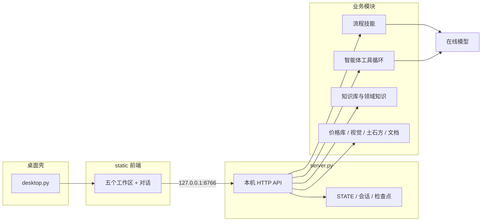

# 电力造价智能体平台

当前版本 **0.8.0**（见 `VERSION`）。开发者：云南中合数维科技有限责任公司。

这是一套跑在 Windows 本机上的桌面程序，用来帮助技经人员核对输变电工程的物资数量和价格，并附带图纸字段识别、价格库、知识库和土石方算量。界面是 WebView2 里的网页，业务在同一个进程的 Python 服务里完成。文字模型和视觉模型都走在线兼容接口，不需要本地 GPU。

它是可安装、可演示、可在真实工程上试跑的开发基线，还没有完成生产验收。结论必须由专业人员复核后才能对外使用。

---

## 1. 先建立这几个概念

读代码之前，先记住这几件事，后面的目录和接口都围绕它们展开。

| 概念 | 含义 |
|---|---|
| 一个窗口、一个服务 | `desktop.py` 打开窗口并拉起 `127.0.0.1:8766`。关掉窗口，服务一起退出 |
| 一份内存状态 | 所有进行中的工程、阶段、对话都在 `server.py` 的 `STATE` 里。同时只处理一个活动任务 |
| 阶段往前走 | 物资评审按「清洗 → 配对 → 数量评审 → 报告」推进。每步结束写检查点，改上游会使下游失效 |
| 模型不碰原文件 | 源 Excel、源图纸只读。发出去的是脱敏后的文本；密钥只留在本次进程内存 |
| 技能就是业务代码 | 清洗、匹配、评审的规则写在可版本化的 Python 技能里，管理员能改、能回退，不是写死在界面上 |

---

## 2. 系统能做什么

侧栏有五个工作区。它们共用登录、模型配置和会话，计算路径彼此独立。

### 2.1 物资智能评审

这是平台的主功能。输入是工程文件夹里的可研估算表和设计清册（XLS / XLSX），输出是配对结果、数量结论和一份 Word 总结。

推荐操作顺序：

1. 对话框左下角添加工程文件夹。程序在本机识别估算表、设计清册和本工程数量列，**这一步不调用在线模型**。
2. 在结果面板查看原文件、工作表和行号。可以改字段并写下原因。源文件不会被改写。
3. 在「模型与连接」里填写接口地址、模型名和 API Key。DeepSeek 预设为 `https://api.deepseek.com` / `deepseek-chat`，也接受其他 OpenAI 兼容地址。
4. 确认清洗结果后执行匹配，检查候选、必要时改配对，再执行数量校核。
5. 逐条确认后生成报告。Word 报告是范围、方法、总体结果、主要问题和建议的总结；逐条明细留在平台表格里。

对话里可以直接说「只处理 主变」「继续」「暂停」。暂停停在当前步骤结束处，不会切断已经发出的模型请求。「只处理」是对两侧原始字段做关键词过滤，不是专业归属推断。

配对和评审会把**脱敏后的**清洗结果发给在线模型。数值比较、单位换算、成套归并仍由流程技能里的确定性规则完成。成套项和组成件按多对多匹配，组成件与所属成套项取同一结论；找不到成套项的组成件按未匹配处理。

结果出来之后的追问（例如「成套物资哪些已匹配」）走智能体循环：模型按工具取数、解释，写操作要先经过校验并在对话里批准。

### 2.2 图纸识别与提资

工作台包含两条并列能力，数据与状态彼此独立：

1. **杆塔提资（默认主工作台，本机确定性提取）**：
   - 包含「资料与探查」「提资明细表」「校验与导出」三个页签，并与底部 3 步流程条（扫描与解析 → 复核与校对 → 校验与导出）联动。
   - 选择施工图目录后，程序在本机按版式归类图纸并判定载体，**仅对 T2 文字坐标流 PDF** 按列边界与行聚类还原杆塔明细，再执行字段映射、查表、区间插值（超区间不外推，标待复核留空）和独立基准双源校验。全程离线，源文件只读，不调用在线模型向单元格写值；同一份 T2 PDF 连续解析两次结果完全一致。
   - 支持单元格坐标级溯源（原页高亮定位）、双击就地修订、`Esc` 标待复核、字段配对确认与改配、图纸缩放框选读取文字层并人工确认写入，以及导出人工复核版（`result.xlsx/csv`）、机器原值版（`result_machine.xlsx/csv`）、修订清单（`revision_log.csv`）和运行报告（`run_report.md`）。
   - 默认模板 `tizi/defaults/config/rules.tower.yaml` 中附带的校验基准（3483.27 t、314.14 t、214 基）仅属于 220kV 龙泉山示例工程配置，切换工程时请按实际材料清册基准调整会话配置。

2. **单图视觉识图（工作台右侧兼容页签）**：
   - 保留原有在线视觉识别路径：上传 PDF 前 3 页或 PNG / JPG / WebP 单张图片，由单独配置的视觉模型抽出可见数字字段并执行接地套数与杆塔基数等工程常识校核。DWG / DXF 需先转成 PDF；这里没有坐标级溯源，模型自报的置信度不是准确率，冲突项须人工确认。

### 2.3 物资价格数据库

导入标准 JSON 或 Excel 价格条目。完全同名同规格才直接比较；口径不一致时拒绝比价，避免把含税价和不含税价放在一起。支持条目审核、环比预警、版本发布和回退。

公开信息价自动采集、PDF 信息价识别、语义编码映射和税口径自动换算还没有接入。

### 2.4 电力知识库

两类知识，用途不同：

- **规范与自定义规则**（`knowledge.py`）：上传 PDF、Word、Excel、TXT、CSV、JSON（单文件 8MB 以内），按条款导入。检索用 SQLite FTS。条目有来源、版本、审核和启停。
- **物资领域知识**（`domain_knowledge/` + `domain_kg.py`）：品类本体、计量参数、成套组成。只有状态为「已审核」的条目可以改变评审结论；「待审核」只作提示。

匹配前会检索与这批物资相关的知识，把编号和出处带到结果里。开放式问答返回可核查引用。

### 2.5 土石方数智化算量

工程量、造价和方案寻优在浏览器里的 three.js 引擎完成（`static/earthwork/engine.js`，随包发布，不访问外网）。后端负责：

- 资料清洗：布置图和勘察报告 → 三维建模用的 DXF、勘探点平面位置图、钻孔分层 CSV，写到资料文件夹下的「土石方清洗成果」
- 三维建模：由清洗成果构三角网、重采样格网 DEM、按钻孔插值地层界面，生成 `model.json`
- 规则质检、方案存档、比选报告

模型只把用户的话转成白名单里的动作，并解读已经算好的汇总。发给模型的是工程量汇总和统计量，不含坐标。

### 2.6 平台内查看和修改 Excel

不需要安装 Microsoft Excel。清洗时保留原始 XLS/XLSX 快照和清洗后的 XLSX，可分页查看全部工作表（每页 100 行、40 列），定位单元格，修改后另存副本。

公式显示公式文本和文件里的缓存值，不会重算。图表、图片和宏不渲染。XLS 另存为 XLSX 时只保留单元格值和合并区域。编辑副本不会自动写回物资核对台账。

### 2.7 对话里还有这些能力

- 右下角麦克风使用 Windows 系统听写
- 结果面板可导出 CSV、JSON 审计包，以及估算 / 清册文本
- 检查点可以恢复旧的中间结果
- 管理员可在「技能开发与管理」里查看、修改、校验和回退技能

---

## 3. 系统架构



| 层 | 位置 | 做什么 |
|---|---|---|
| 窗口 | `desktop.py`、`desktop_features.py` | 启动和关闭服务、原生菜单、选择文件夹、语音输入 |
| 界面 | `static/` | 纯 HTML / CSS / JavaScript，没有前端构建步骤 |
| 宿主 | `server.py` | 路由、登录、会话、检查点、脱敏、把请求分给各模块 |
| 业务 | 根目录各 `*.py` | 清洗、匹配、评审、价格、图纸、土石方、文档 |
| 技能源码 | `skill_templates/` | 可版本化的业务规则。运行副本在数据目录，不直接改模板文件 |

固定指令不经过智能体，由 `server.py` 直接执行。这类指令包括添加并清洗工程、继续下一步、暂停、调整价格阈值、修改技能。

物资评审的阶段记在 `STATE['stage']`：

| 阶段 | 发生什么 |
|---|---|
| 清洗完成，等待匹配 | 本机读表，保留文件、工作表、行号 |
| 候选配对 | `match_pairs`：模型给出候选，规则做校验和成套归并 |
| 数量评审 | `build_rows` + `review`：换算、逐行核对、组级定档、领域知识定档 |
| 报告 | 生成 Word 总结，阶段结束 |

每步成功后调用 `checkpoint()`。修改清洗记录、配对、范围或模型，会使更后面的结果失效。

结果追问走 `agent.py`。工具用 JSON Schema 注册。模型优先使用原生工具调用；接口不接受 `tools` 参数时，改用 JSON 动作协议。一次回答最多 12 轮工具调用。只读工具包括查匹配结果、按编号取条目、项目概况、知识库检索、联网检索、匹配方法说明。改结论、确认复核、改配对在执行前先跑流程技能「评审·修改校验」，再按权限模式弹出批准卡片。批准前循环暂停。每次修改先存检查点，最近一次可以撤销。

---

## 4. 代码怎么分

源码平铺在项目根目录，没有 `src` 包。新接触项目时，按下面的分组找文件。

```text
PowerCostingAI/
├── desktop.py                  窗口入口
├── server.py                   HTTP 服务与总调度
│
├── 物资评审
│   ├── folder_cleaning.py      扫描工程目录
│   ├── cleaning.py             读取表格、抽出估算和清册行
│   ├── cleaning_reference.py   与人工基准 JSON 逐条核对
│   ├── pipeline_skills.py      加载、校验、执行流程技能
│   ├── LLM_service.py          配对与评审的模型调用
│   ├── llm_client.py           OpenAI 兼容 HTTP 客户端
│   ├── desensitize.py          发出前脱敏、返回后还原
│   ├── agent.py                追问用的工具循环
│   ├── result_qa.py            依据匹配结果作答
│   ├── project_qa.py           项目概况与受控查询
│   └── web_search.py           联网检索
│
├── 技能
│   ├── skill_runtime.py        规则技能沙箱
│   ├── custom_skills.py        自定义技能
│   ├── skills.json             平台技能清单
│   └── skill_templates/        技能源码模板
│       └── pipeline/           15 个流程技能
│
├── 知识、价格、图纸、文档
│   ├── knowledge.py  standards.py  domain_kg.py
│   ├── domain_knowledge/       品类、参数、成套组成的 JSON
│   ├── price_library.py
│   ├── platform_tools.py       视觉识别
│   ├── document_tools.py       Word 报告、Excel 明细
│   └── excel_skills.py         平台内看表、改副本
│
├── 土石方
│   ├── earthwork.py            方案、质检、报告接口
│   ├── earthwork_clean.py      资料清洗编排
│   ├── earthwork_pdf.py  earthwork_dxf.py  earthwork_survey.py
│   ├── earthwork_geom.py  earthwork_tin.py  earthwork_contours.py
│   ├── earthwork_model.py      生成 model.json
│   ├── earthwork_preview.py    PDF 页面渲染
│   └── static/earthwork/       前端计算引擎与三维场景
│
├── 账号与发布
│   ├── auth.py  protected.py
│   └── build.ps1  build_secure.py  installer.py
│
├── static/                     界面
├── docs/                       架构、技能、领域知识、版本说明
└── test_*.py                   unittest，按模块拆分
```

`static/` 里和界面对应的脚本：

| 文件 | 内容 |
|---|---|
| `index.html` / `app.js` | 页面骨架、视图切换、评审主流程 |
| `login.html` / `auth-ui.js` | 登录 |
| `folder-ui.js` / `clean-ui.js` | 选工程、看清洗结果 |
| `excel-ui.js` / `docs-ui.js` | 原表对照、成果文档 |
| `skills-ui.js` | 技能工作室 |
| `earthwork-ui.js` + `static/earthwork/` | 土石方 |
| `task-ui.js` / `extras.js` / `menus.js` | 任务类型、图纸与知识库、原生菜单动作 |

更细的边界和限制见 [docs/ARCHITECTURE.md](docs/ARCHITECTURE.md)。

---

## 5. 三套技能

左侧「技能开发与管理」只对管理员开放。三类技能都能保留版本并回退，约束不同。

| 类别 | 代码 | 能做什么 |
|---|---|---|
| 流程技能 | `pipeline_skills.py`，模板在 `skill_templates/pipeline/` | 真正执行清洗、匹配、评审。可导入 `re`、`math`、`json`、`collections` 等纯计算模块。文件、网络和模型调用只能通过宿主传入的 `ctx` |
| 规则技能 | `skill_runtime.py`，模板在 `skill_templates/*.py` | 契约规定的几个纯函数，例如选表范围、价格分档、图纸字段校核。禁止 import、循环和系统调用 |
| 自定义技能 | `custom_skills.py` | 用户自己的数据处理。入口固定为 `run(data)`，输入输出都是 JSON。在独立进程里执行，5 秒超时 |

15 个流程技能，顺序就是运行顺序：

| 阶段 | 技能 id | 名称 |
|---|---|---|
| 数据清洗 | `table_selection` | 清洗·选表与列映射 |
| 数据清洗 | `row_extraction` | 清洗·逐行提取 |
| 公共规则 | `text_rules` | 公共·文本与型号规则 |
| 物资匹配 | `candidate_pairing` | 匹配·候选配对 |
| 物资匹配 | `rule_check` | 匹配·规则校验 |
| 物资匹配 | `set_coverage` | 匹配·成套项整体比对 |
| 物资匹配 | `set_matching` | 匹配·成套对应（多对多） |
| 物资匹配 | `check_units` | 匹配·核对单元分组 |
| 数量评审 | `quantity_rules` | 评审·计量与换算 |
| 数量评审 | `row_review` | 评审·逐行核对 |
| 数量评审 | `group_review` | 评审·组级定档 |
| 数量评审 | `knowledge_apply` | 评审·领域知识定档 |
| 流程编排 | `match_flow` | 流程·匹配与评审编排 |
| 结果导出 | `result_export` | 导出·结果字段 |
| 结果修改 | `edit_check` | 评审·修改校验 |

保存流程技能之前，会检查语法、导入白名单和接口函数，再用内置样例把整条流程跑通。结构不合法就拒绝保存。保存后，受影响的清洗、匹配或评审结果会失效，需要重跑对应步骤。未改过的技能随程序升级更新；改过的保留用户版本，并提示内置模板有更新。

自定义技能的示例包在 `examples/material_cost_total.skill.json`。导入只校验，不执行，默认停用。详细操作见 [docs/SKILL_STUDIO.md](docs/SKILL_STUDIO.md)。

这三套约束都是代码审查，不是操作系统级沙箱。只保存经过审查的代码。

---

## 6. 数据、登录和安全

| 项 | 开发运行 | 安装版 |
|---|---|---|
| 数据目录 | 项目下的 `runtime/` | `%LOCALAPPDATA%\PowerCostAgent\data` |
| 技能与检查点 | 明文 JSON | 加密存储 |
| 监听地址 | `127.0.0.1:8766` | 同左，可用环境变量 `POWER_COST_PORT` 改端口 |

可用 `POWER_COST_DATA_DIR` 指定数据目录。程序不会在启动时迁移旧项目 `D:\Power_AI_0623\agent_demo` 的工程数据和密钥。

登录由 `auth.py` 处理：

- 预置管理员账号 `admin`。初始口令由管理员另行告知，不写在源码和本说明里
- 口令以 PBKDF2 摘要存在数据目录 `users.json`
- 会话令牌只在服务进程内存，通过 HttpOnly Cookie 传递
- 所有接口都要登录。技能开发与管理只允许管理员
- 连续输错 5 次，账号锁定 5 分钟
- 删除 `users.json` 会恢复为只有预置管理员的初始状态

安装包由 `build.ps1` 调用 `build_secure.py`：业务模块用 Nuitka 编译成 `.pyd`，技能模板和 `LLM_service.py` 加密成 `.pye`，再用 PyInstaller 组装。`protected.py` 在安装版启动时校验完整性，并拒绝调试器。开发环境读写明文，不走这套保护。

API Key 不进源码、不进 Git、不进检查点、不进安装包。重启后需要重新填写。

---

## 7. 环境与启动

需要 **Python 3.11+** 和 **Microsoft Edge WebView2 Runtime**。现代 Windows 通常已经带有 WebView2。

```powershell
python -m venv .venv
.venv\Scripts\python -m pip install -r requirements.txt
.venv\Scripts\python desktop.py
```

已有 Python 3.11 及以上的 conda 环境时，激活后在项目目录执行 `python desktop.py` 即可，不必再新建 `.venv`。依赖见 `requirements.txt`：`openpyxl`、`xlrd`、`requests`、`python-docx`、`pypdf`、`pypdfium2`、`Pillow`、`pywebview`。

启动后先进入登录页。窗口标题为「电力造价智能体平台」。只想看 HTTP 接口时，可以运行 `python server.py`，但没有原生选文件夹和窗口菜单。

常用快捷键：Ctrl+O 添加工程，Ctrl+Enter 发送，Ctrl+B 折叠侧栏，Ctrl+J 打开结果面板，F1 帮助。

---

## 8. 建议的阅读顺序

按这个顺序读，能从「窗口怎么起来」走到「一条物资是怎么配对的」。

1. 本文，建立工作区和阶段的概念
2. [docs/ARCHITECTURE.md](docs/ARCHITECTURE.md)，看边界：什么已经做了，什么明确还没做
3. `desktop.py`：窗口如何拉起服务、如何在关闭时停掉服务
4. `server.py` 里的 `STATE`、`advance()`，以及 `route == '/api/` 那一段路由
5. `pipeline_skills.py` 顶部的 `SKILLS` 列表，再打开 `skill_templates/pipeline/match_flow.py` 看编排
6. `LLM_service.py` 与 `desensitize.py`：模型看到什么、本机留下什么
7. `agent.py`：追问时工具如何注册、如何在批准前暂停
8. `static/index.html` 与 `static/app.js`：五个视图如何切换
9. 按需阅读 [docs/SKILL_STUDIO.md](docs/SKILL_STUDIO.md)、[docs/DOMAIN_KNOWLEDGE.md](docs/DOMAIN_KNOWLEDGE.md)、[docs/VERSIONING.md](docs/VERSIONING.md)

改某个工作区时，只需要顺着对应模块往下看，不必先通读 `server.py` 全文。`server.py` 是总调度，业务规则在流程技能和各工作区模块里。

---

## 9. 测试与打包

```powershell
python -m unittest test_workflow test_extensions test_custom_skills test_folder_cleaning test_cleaning_reference test_excel_skills test_llm_client test_domain_knowledge test_knowledge_integration test_pipeline_skills
```

土石方计算引擎：

```powershell
node static/earthwork/engine.test.mjs
```

其余 `test_*.py` 按模块覆盖登录、会话、价格库、脱敏、智能体、土石方清洗等，可按文件名单独运行。

打包：

```powershell
.\build.ps1
```

Nuitka 与 MinGW 不能放在中文路径下。首次构建会把编译器装到 `%TEMP%\pca-build-tools`，编译发生在 `%TEMP%\pca-secure-build`，需要联网。安装包输出到 `release/PowerCostAgent-Setup-<版本号>.exe`。首次构建需要准备 `samples/估算数据.txt` 和 `samples/清册数据.txt`，这两份样例不纳入 Git。安装包目前不做代码签名。

---

## 10. 已知边界

- 单用户、单活动任务，没有企业多用户权限和生产级任务队列
- 清洗规则面向已适配的造价表格式。土建清册默认排除；多工程数量列无法确认时标为待确认
- 离线或未配置模型时，配对退化为保守的精确文本匹配，不能代表在线效果
- 视觉识别已接入在线接口，复杂工程图纸的准确率仍需用标注样本验收
- Word / Excel 是有限操作集：替换文字、追加段落、写单元格，不是 Office 全功能编辑
- 正式出版模板和 PDF 报告自动渲染尚未接入
- 尚未做大型工程验收、并发压力测试、安装包签名和自动更新

业务口径和换算参数以领域知识库及经过审核的技能为准。平台上看到的分布是结论统计，不是准确率。
