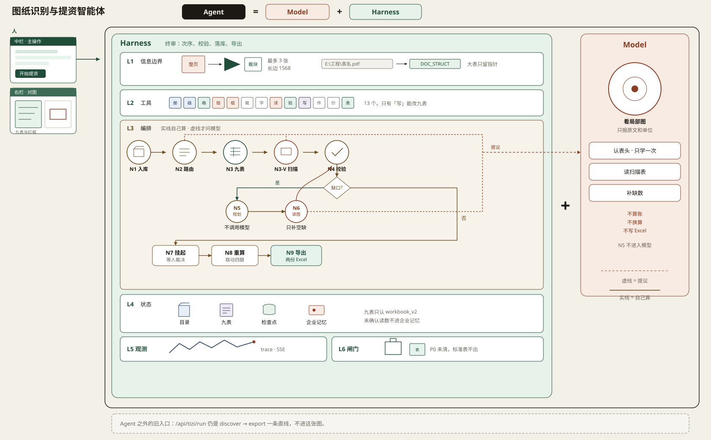
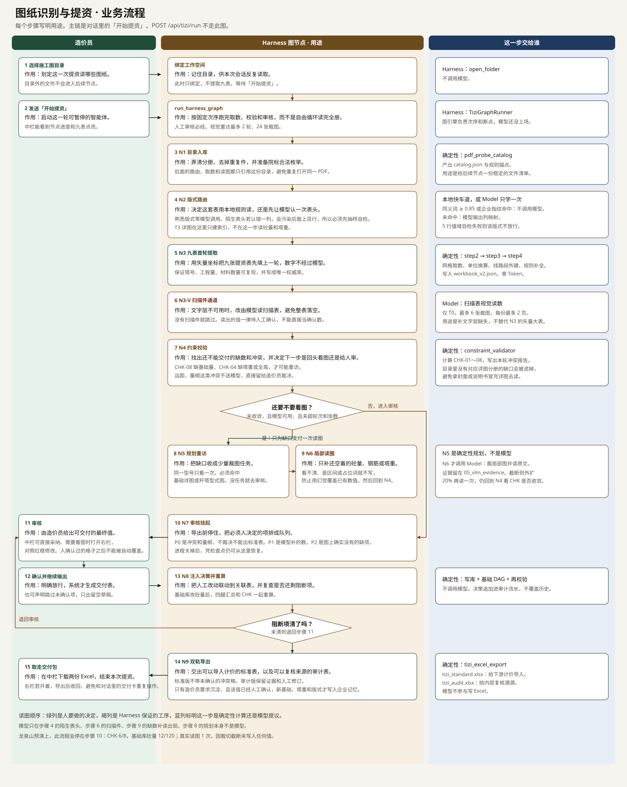

# 图纸识别与提资 · 架构与业务流程

图按 `PowerCostingAI` 当前代码绘制，并对照《图纸识别与提资智能体方案》。架构图以 **Agent = Model + Harness** 为总结构：模型只有提议权，Harness 六层负责编排、校验、落库和导出。业务流程图在每个步骤上写明该步的作用。

- [架构图 PNG](./图纸识别与提资-架构图.png)
- [架构图 SVG](./图纸识别与提资-架构图.svg)（保留）
- [业务流程图](./图纸识别与提资-业务流程图.svg)

## 读图时需要知道的差异

1. 对话里的「开始提资」走 `TiziGraphRunner`（N1→N2→N3→N3-V→N4，再按条件进入 N5/N6 或 N7）。`POST /api/tizi/run` 仍走 `job.run_steps` 的线性步骤，不经过这张图。
2. N3 与 N3-V 是串行。N3-V 只处理扫描件 / T0。T3 详图不在首轮视觉车道，只在 N4 报出 CHK-04 或 CHK-08 且命中对应分册后，由 N6 补读。
3. N5 是确定性规划。`revisit_planner_v1.md` 已在仓库中，运行时没有调用。模型只出现在学表头、扫描件读表、局部视觉重访三处，且只有提议权。
