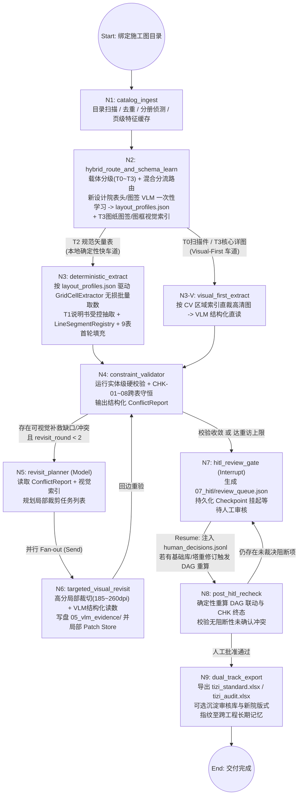
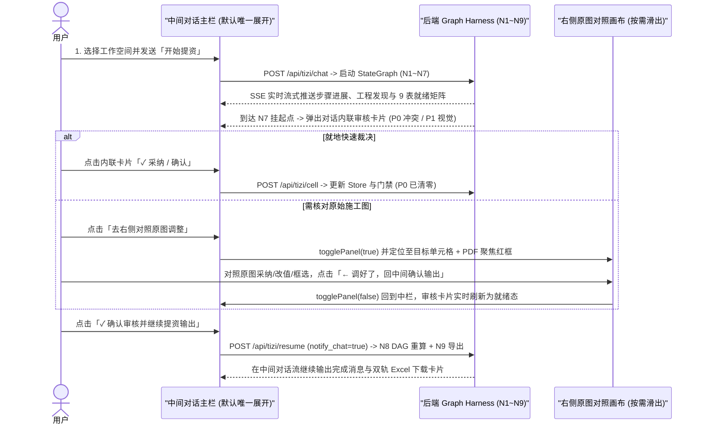
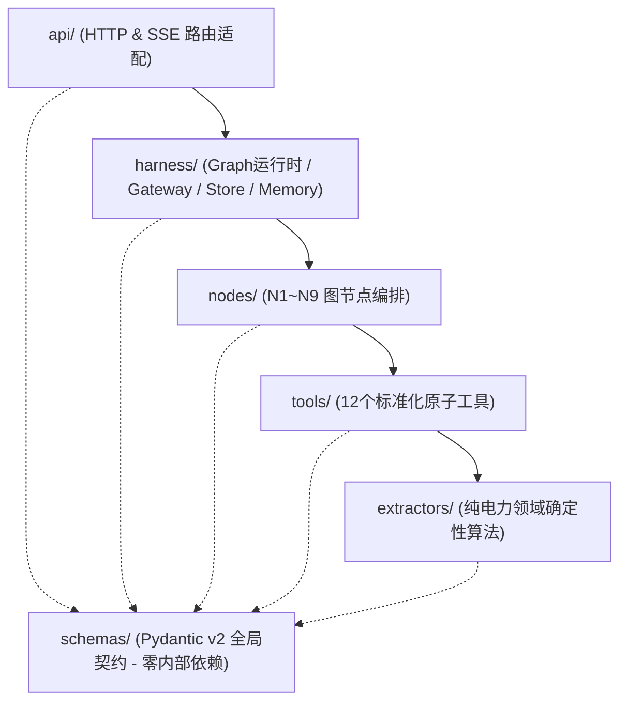

# 图纸识别与提资智能体方案（Agent = Model + Harness）

> **编制依据**：基于 `PowerCostingAI v0.15.2`（`dev_liuyucheng` 分支，`tizi/` 现存 28 个源码模块、`server.py` 与 `static/tizi-ui.js`）源码级认证分析  
> **目标范式**：`Agent = Model + Harness`（以可编程、可验证、可暂停恢复的工程 Harness 为第一设计对象，以多模态/推理 Model 专攻几何视觉与语义裁决）  
> **适用范围**：输电线路施工图多册 PDF 识别、院标 9 张提资表生成、双源守恒校验、人机协同复核与标准/溯源双轨 Excel 交付

---

## 第一阶段：现有 `tizi` 功能现状认证分析（源码证据驱动）

### 1.1 功能链路盘点与真实调用链

当前系统存在**两条完全割裂的执行链路**：一条是 `tizi/` 目录下的**纯确定性无模型全工作簿管线**（主链路），另一条是遗留在 `server.py` 中的**单图在线视觉抽取接口**（旁路）。

#### （1）主链路调用链（确定性 9 表提取，零模型调用）

```mermaid
flowchart LR
    FE["static/tizi-ui.js\nopenTiziFolder() / runTizi() / connectTiziStream()"]
    API["server.py\nhandle_tizi_post():2242\nhandle_tizi_get():2092"]
    JOB["tizi/job.py\nTiziJob.run_steps():461\nworker() 后台线程"]
    P0["pipeline.py:step0_discover():165\ndiscover.build() + to_configs()\n+ detect_aux_sources()"]
    P1["pipeline.py:step1_carrier():293\ncarrier.inspect()\n-> cache.get_doc_features()"]
    P2["pipeline.py:step2_parse():363\nparse_table.parse()"]
    P3["pipeline.py:step3_mapping():404\ntransform.apply()"]
    P4["pipeline.py:step4_rules():438\nrules.apply_rules()\n-> sync_workbook_sheets():796"]
    P5["pipeline.py:step5_validate():462\nvalidate.run_checks()\n+ recompute_workbook_checks():1022"]
    P6["pipeline.py:step6_output()/export_bundle():756\nwriter.export_pair()\n+ template_writer.export_workbook_pair()"]

    FE -->|"POST /api/tizi/run\nGET /api/tizi/stream"| API
    API --> JOB --> P0 --> P1 --> P2 --> P3 --> P4 --> P5 --> P6
```



在 `sync_workbook_sheets()`（`tizi/pipeline.py:796-1015`）内部，硬编码顺序调用 9 个领域抽取器：

1. `basic_info.parse_basic_info_pdf()`（`tizi/extractors/basic_info.py:238`）→ 写入 `store["基本信息"]` → 调用 `LineSegmentRegistry.from_basic_and_towers()`（`tizi/segments.py:21`）建立跨表线路段外键表。
2. `tower_v2.build_tower_sheet_v2()`（`tizi/extractors/tower_v2.py:146`）→ 内部直接拉起 `rho.parse_rho_pdf()`（`rho.py:59`）、`grounding.parse_grounding_pdf()`（`grounding.py:58`）与 `crossing.parse_crossing_pdf()`（`crossing.py:111`）→ 写入 `store["杆塔明细表"]` 与 `store.excluded_gantries`。
3. `materials.parse_materials_pdf()`（`tizi/extractors/materials.py:259`，内部调用 `grid_parser.GridCellExtractor.extract_page()`）+ `crossing.parse_material_book_crossings()`（`crossing.py:62`）→ 写入 `store["结构/电气/光缆设备材料表"]`。
4. `strings.build_strings_sheet()`（`tizi/extractors/strings.py:48`）→ 聚合电气/光缆表写入 `store["串型汇总表"]`。
5. `survey.build_survey_sheet()`（`tizi/extractors/survey.py:205`，有报告调 `parse_survey_pdf()`，缺报告按 `rho_records` 降级）→ 写入 `store["勘测信息一览表"]`。
6. `foundation.build_foundation_sheets()`（`tizi/extractors/foundation.py:138`）+ `recalc_foundation_links()`（`foundation.py:335`）→ 写入 `store["基础明细表"]` 与 `store["基础库"]`。
7. `recompute_workbook_checks()`（`pipeline.py:1022`）→ 计算 `CHK-01 ~ CHK-08`。

**外部依赖与调用清单**（`requirements.txt:1-10` 与源码实证）：
- **PDF 解析与渲染**：`pymupdf`（`cache.py:17`, `parse_table.py:10`, `drawing.py:9`, `ocr_local.py:12`）。
- **离线局部 OCR（仅人工弹窗点按）**：`ocr_local.py:35-85`，优先尝试 `pytesseract`，不可用时在 Windows 上通过 `subprocess.run(["powershell", ...])` 调用系统 `WinRT OcrEngine`。
- **平台价格库（只读）**：`server.py:2354` 将 `STATE['prices']` 快照传入 `price_match.match_sheet_prices()`（`price_match.py:54`）。
- **Excel 读写**：`openpyxl`（`writer.py`, `template_writer.py`）。

#### （2）旁路调用链（遗留单图在线视觉入口，与 `tizi/` 割裂）

- `POST /api/drawing/recognize` → `server.py:recognize_drawing():2779` → `KB.search('架空线路图纸交叉校核 提资字段')` → `vision_extract()`（仅处理上传 PDF 前 3 页）→ 写入 `STATE['drawing']`（`server.py:2783`）。
- **认证结论**：该视觉链路既无法读取 `tizi/` 的 9 表状态与约束缺口，也无法将其视觉识别结果写回 `ProjectTiziStore`，二者仅在前端通过「单图视觉识图」页签勉强并列展示（`static/tizi-ui.js:144`）。

---

### 1.2 Harness 六层体系缺位认证诊断

对照标准 Agent Harness 六层体系，对 `tizi/` 现存实现做逐层认证：

| Harness 层级 | 现状评级 | 源码证据与诊断结论 |
| :--- | :--- | :--- |
| **1. 信息边界层**<br>*(Context & Information Boundary)* | **有雏形但边界不清** | **已有**：`cache.py:get_doc_features()` 对 PDF 做内容指纹页级缓存；`server.py:2270` 规定对话消息不写入未脱敏本地路径。<br>**缺位**：(1) 管线内部各函数直接传递整本 PDF 的全量 `pages`/`words` 列表，无按需裁切、Token/字节预算控制与敏感词脱敏网关；(2) 无面向多模态模型的视觉输入封装（如按图框/表区裁剪分辨率控制）。 |
| **2. 工具系统层**<br>*(Tool System & Contract)* | **隐式存在未工程化** | **已有**：解析、渲染、OCR、价格匹配能力分别散落在 `grid_parser.py`、`drawing.py`、`ocr_local.py`、`price_match.py`。<br>**缺位**：(1) 无统一工具注册表与输入/输出 JSON Schema；(2) `tower_v2.py:170-184` 等模块间直接硬编码导入函数调用；(3) 无副作用分级（只读/工件写/状态写/外部导出）与统一错误码契约，Model 无法发现和调度任何工具。 |
| **3. 执行编排层**<br>*(Execution Orchestration)* | **隐式存在未工程化（线性无闭环）** | **已有**：`job.py:run_steps():461` 实现了单线程顺序循环 `for st in step_list: method_map[st]()`。<br>**缺位**：(1) 纯前向开环流水线，无条件分支与“校验失败→回边重试”机制；(2) 无节点级 Checkpoint，单步重跑依赖前端手动点按 `重跑：[step]`；(3) 无多实体的并行扇出（Fan-out）与归并（Reduce）调度。 |
| **4. 记忆与状态层**<br>*(Memory & State)* | **有雏形但边界不清** | **已有**：`store.py:ProjectTiziStore` 维护 9 张表与修订栈；`job.py:_save():247` 原子落盘 `job.json`。<br>**缺位**：(1) V1 `pipe.rows`（215 行含构架）与 V2 `store`（214 行）双轨状态并存（`job.py:350-407`）；(2) 所有中间状态塞进单个 `job.json`，未使用文件系统分层目录作为协作原语；(3) **完全缺失跨工程长期记忆**，人工补齐的非标基础型号（如 `WZ1055`）无法自动复用至后续工程。 |
| **5. 评估与观测层**<br>*(Evaluation & Observability)* | **有雏形但边界不清** | **已有**：`job.py:_push_stream_event():157` + `server.py:/api/tizi/stream:2100` 实现了实时 SSE 进度推送；有 8 套单元测试（69 用例）。<br>**缺位**：(1) 缺失模型/工具调用级 Trace（入参图片、Prompt、输出、耗时、Token 成本回放）；(2) 缺失对照人工真值表的离线自动评测套件（F1、完整率、返工率指标尚未自动化采集）。 |
| **6. 约束验证与恢复层**<br>*(Constraint Verification & Recovery)* | **有雏形但仅后置告警，缺闭环恢复** | **已有**：`pipeline.py:recompute_workbook_checks():1022` 实现 `CHK-01~08`；`materials.py:205,233` 实现量纲拦截与充盈量剔除；`basic_info.py:175` 实现运距单位冲突检测。<br>**缺位**：验证器**不是可触发恢复动作的闭环组件**，仅在末尾输出红/黄告警（例如 `CHK-08` 覆盖率仅 23.4%、`CHK-04` 缺失 `NA117` 塔重），系统无法自动定位相关图纸局部区域发起定向重读或异常自愈。 |

---

### 1.3 现有实现已知缺陷归纳（带代码坐标）

#### （1）导致识别不准的具体环节

| 缺陷编号 | 缺陷现象与根因 | 对应代码位置 |
| :--- | :--- | :--- |
| **D-01** | **电阻率表列区间实质硬编码**：`_detect_bounds()` 即使检测到表头偏移，两个分支均返回写死的 `_DEFAULT_BOUNDS`（如 `塔号 70~118`, `推荐 540~590`），更换设计院版式即整表错列。 | [tizi/extractors/rho.py](file:///E:/提资项目/PowerCostingAI/tizi/extractors/rho.py#L10-L45) |
| **D-02** | **接地参数表纯文本偶位切片脆弱**：`parse_grounding_pdf()` 通过 `_grab_nums(txt, "总重", 14)` 加 `raw_wt[0::2]` 假定文字层按“总重/单重”交替排列；`_table_bbox()` 仅取整表粗大外框，无法精确到具体档位格。 | [tizi/extractors/grounding.py](file:///E:/提资项目/PowerCostingAI/tizi/extractors/grounding.py#L44-L80) |
| **D-03** | **主表解析未接入框线网格引擎**：`step2_parse()` 仍采用 `parse_table.py` 固定 x 区间 + `3.5pt` y 聚类，对跨行折行、无规则间距或双层合并表头的新院结构册鲁棒性弱于 `GridCellExtractor`。 | [tizi/parse_table.py](file:///E:/提资项目/PowerCostingAI/tizi/parse_table.py#L34-L75) |
| **D-04** | **线路段归属与跨越塔号前缀硬编码**：`LineSegmentRegistry` 依赖字母硬规则（`p == "A"`, `p == "D"`, `p in ("E", "F")`）；`crossing.py` 正则 `_SPAN_RE` 写死 `N[A-F]`，超范围命名体系会退回首段或漏提。 | [tizi/segments.py](file:///E:/提资项目/PowerCostingAI/tizi/segments.py#L60-L78)、[tizi/extractors/crossing.py](file:///E:/提资项目/PowerCostingAI/tizi/extractors/crossing.py#L12) |
| **D-05** | **材料清册路由强依赖特定表头措辞**：`_detect_header_section()` 与 `_update_section_from_text()` 依赖 `"材料规格或型号"`、`"物资类别"`、`"电气材料"` 等精确字面匹配，跨院标清册易路由错误。 | [tizi/extractors/materials.py](file:///E:/提资项目/PowerCostingAI/tizi/extractors/materials.py#L184-L193)、[L292-L314](file:///E:/提资项目/PowerCostingAI/tizi/extractors/materials.py#L292-L314) |

#### （2）导致提资遗漏的具体环节

| 缺陷编号 | 缺陷现象与根因 | 对应代码位置 |
| :--- | :--- | :--- |
| **D-06** | **非标基础详图（T3 矢量）全量跳过导致 `CHK-08` 仅覆盖 23.4%**：`std_foundation_lib.csv` 仅内置 20 个标准型号；真实工程 120 种基础型号中 `WZ1055`/`WK1065`/`WK1275` 等 70+ 非标型号全标 `pending` 留空，主链不读基础详图。 | [tizi/extractors/foundation.py](file:///E:/提资项目/PowerCostingAI/tizi/extractors/foundation.py#L242-L315)、[tizi/defaults/data/std_foundation_lib.csv](file:///E:/提资项目/PowerCostingAI/tizi/defaults/data/std_foundation_lib.csv) |
| **D-07** | **新塔型与塔头高缺失无视觉兜底导致 `CHK-04` 停在 91%**：`NA117 (2E1Y7-GFJ3)` 缺呼高/塔重、`2E2Y6-J4` 缺塔头高，系统无法自动去《全线杆塔型式一览图》（T3）视觉补读单基重与塔头高。 | [tizi/extractors/tower_v2.py](file:///E:/提资项目/PowerCostingAI/tizi/extractors/tower_v2.py#L261-L300)、[tizi/rules.py](file:///E:/提资项目/PowerCostingAI/tizi/rules.py#L126-L146) |
| **D-08** | **同一塔位多条交叉跨越被静默丢弃**：`parse_crossing_pdf()` 使用 `if tower_id in results: continue`，同档跨越多条电力线/公路时仅保留首条，其余直接丢失；材料清册常规跨越 `parse_material_book_crossings()` 仅存 `meta` 计数未入表。 | [tizi/extractors/crossing.py](file:///E:/提资项目/PowerCostingAI/tizi/extractors/crossing.py#L148-L149)、[tizi/pipeline.py](file:///E:/提资项目/PowerCostingAI/tizi/pipeline.py#L844-L855) |
| **D-09** | **缺独立 PDF 勘察报告时无法读 `.docx`/扫描件**：`survey.py` 仅支持 T2 PDF 附表，缺省时整表 214 行降级为单层 100% 土质骨架。 | [tizi/extractors/survey.py](file:///E:/提资项目/PowerCostingAI/tizi/extractors/survey.py#L215-L256) |

#### （3）导致难以调试与演进的具体环节

| 缺陷编号 | 缺陷现象与根因 | 对应代码位置 |
| :--- | :--- | :--- |
| **D-10** | **单体 `job.json` + V1/V2 双口径耦合**：`job.json` 混存 V1 `pipe.rows`（215 行）与 V2 `store`（214 行）及流式轨迹，无法按阶段独立检查/diff 中间工件。 | [tizi/job.py](file:///E:/提资项目/PowerCostingAI/tizi/job.py#L247-L280)、[L350-L407](file:///E:/提资项目/PowerCostingAI/tizi/job.py#L350-L407) |
| **D-11** | **局部 OCR 跨平台与冷启动瓶颈**：`ocr_local.py` 兜底每次均用 `subprocess.run(["powershell", ...])` 拉起新进程加载 WinRT，延迟 1–2s 且 Linux 服务器不可用。 | [tizi/ocr_local.py](file:///E:/提资项目/PowerCostingAI/tizi/ocr_local.py#L51-L88) |
| **D-12** | **前端单文件强耦合**：`static/tizi-ui.js` 已达 2289 行，流式卡片、表格、双弹窗与状态管理揉在单一 IIFE 中，增加 HITL 审批流与视觉证据对比时维护成本高。 | [static/tizi-ui.js](file:///E:/提资项目/PowerCostingAI/static/tizi-ui.js) |

---

## 第二阶段：图纸识别与提资智能体方案规划（Agent = Model + Harness）

---

### A. Harness 架构选型与六层体系设计

#### A.1 四种 Harness 架构对比与明确选型

针对输电线路图纸提资的三大刚性业务约束——**① 多分册强拓扑依赖（9 表外键与级联汇总）**、**② 约束失败需按实体定点重读局部原图（不可重跑 344 页全册）**、**③ 导出前必须可跨小时/跨重启挂起等待造价员 HITL 审核**——对四种主流 Harness 架构逐一裁决：

| 架构类型 | 适配度 | 针对图纸提资业务的优劣裁决 |
| :--- | :--- | :--- |
| **Loop（纯 ReAct 自主循环）** | ❌ 不选 | 无法强保证 `基本信息 → LineSegmentRegistry → 9 表 → CHK` 的拓扑次序；自由循环调用工具易重复读 344 页 PDF 引发 Token 爆炸和上下文腐烂；缺乏原生节点级断点恢复语义。 |
| **Microkernel（微内核插件总线）** | ❌ 不作主骨架 | 擅长工具/插件热插拔（其思想可吸收进 L2 工具注册表），但内核本身不具备条件回边与持久化暂停/恢复状态机，仍需在其上另建图编排引擎。 |
| **Multi-Agent（自由多智能体协商）** | ❌ 不选 | 9 张提资表共享唯一权威外键与守恒方程（`CHK-01~08`），多 Agent 自由对话协商易造成状态分叉、归因模糊与高额推理开销，违背工程造价“单一权威真源 + 确定性可复现”原则。 |
| **Graph（带受控回边的有向状态图）** | ✅ **明确选型** | 天然映射“确定性首轮提取 → 约束验证 → **受控局部视觉重访回边**（单实体有界 Loop `max_revisits=2`）→ **持久化 HITL 审核中断点** → 院标双轨导出”的完整闭环；每个节点可独立 Checkpoint、失败定点重试、多实体安全扇出归并。 |

> **核心架构定调**：**Graph-First Harness（宏观有向状态图） + 局部有界闭环（Bounded Revisit Loop） + 混合分层路由（本地确定性取大表、视觉模型管跨院泛化与详图/冲突补位）**。

#### A.2 Harness 执行状态图拓扑（L3 执行编排层）



##### 混合分层路由规则（该走本地走本地，该走视觉走视觉）

在节点 `N2` 由确定性路由器按“载体形态 × 模板命中率 × 几何复杂度”自动分流，避免“纯规则不泛化”或“全量走 VLM 又慢又串行”两个极端：

| 识别对象 / 业务场景 | 路由去向 | 触发条件 | 核心收益 |
| :--- | :--- | :--- | :--- |
| **陌生设计院的 T2 表头与命名规则** | **视觉模型（每类表仅调 1 次）** | 表头结构指纹未命中 `enterprise_memory` 或本地同义词匹配分 `< 0.85` | 截取**表头 + 前 3 行样例 + 图签**交 VLM 一次性产出 `layout_profiles.json`（列语义、单位、塔号正则），零代码适配新设计院 |
| **规范矢量大表全量行（T2 杆塔/材料/电阻率表）** | **本地确定性引擎（快车道）** | 载体为 `T2` 且已具备 `layout_profiles.json`（缓存命中或 VLM 刚学习完成） | 本地 `GridCellExtractor` 按网格线毫秒级无损提取数百行数字，**零 Token、零串行、无小数点幻觉** |
| **扫描件 / 文字转曲 PDF（`T0`）与强几何详图（`T3`）** | **视觉模型（Visual-First 车道）** | 矢量字密度低于阈值、文字已转曲，或属于基础详图/杆塔型式图/平断面跨越图 | 保留 CAD 引线、边框、剖面与空间拓扑，彻底规避 OCR 丢失结构信息 |
| **工程算量、单位换算、`CHK-01~08` 校核、Excel 导出** | **100% 本地确定性代码** | 强制规则，无例外 | 100% 确定可复现、可审计 |
| **校验报错 / 缺库 / 低置信度孤立单元格** | **视觉模型（冲突触发定向重访）** | `N4` 产出 `revisitable_gaps[]`（如 `CHK-08` 非标基础、`CHK-04` 缺塔重） | 只为最后 10%~20% 的疑难缺口支付视觉推理成本 |

#### A.3 Harness 六层体系业务化详细设计

##### 1. L1 信息边界层（Information Boundary）
- **双向脱敏网关**：任何发往在线 VLM/LLM 的文本与图像元数据必须经过 `DesensitizeGateway`——本地绝对路径替换为相对分册别名（如 `DOC_STRUCT`, `DOC_FDN_03`），工程全称替换为 `SEGMENT_1..N`，响应写回本地时无感还原。
- **视觉裁切硬预算**：禁止向多模态模型发送整本 PDF 或超高像素整页图；单次 `vlm_visual_read` 限制 `≤3` 张局部裁切图、长边 `≤1568px`（清晰度足以辨识 CAD 6pt 标注数字，同时控死单次推理 Token 在 `≤1,500` vision tokens）。
- **Artifact-by-Reference（大对象不入上下文）**：工具返回的表格数据、完整校验明细一律落盘为 JSON 文件，仅向 Model 上下文返回 `{artifact_uri, summary, issue_count}` 指针。

##### 2. L2 工具系统层（标准化 Tool 清单）

所有能力封装为无状态、带 Pydantic 强契约与幂等键的标准化 Tool：

| 工具名 | 副作用级别 | 输入 Schema（核心字段） | 输出 Schema（核心字段） | 调用时机 |
| :--- | :--- | :--- | :--- | :--- |
| `pdf_probe_catalog` | Read-Only | `folder_path`, `exclude_dirs` | `catalog_uri`, `files[]`, `aux_sources{}`, `duplicates` | 节点 `N1`，冷启动扫描目录与分册定性 |
| `pdf_extract_grid` | Artifact-Write | `doc_id`, `pages[]`, `mode: grid\|band`, `layout_profile_uri?` | `grid_artifact_uri`, `row_count`, `headers[]`, `banners[]`, `mapped_columns{}` | 节点 `N3`，按已命中或 VLM 学习的 `layout_profile` 对 `T2`/`T2+T3` 表格页做无损几何还原 |
| `vlm_learn_layout_schema` | Artifact-Write | `doc_id`, `header_sample_crop_uri`, `title_block_crop_uri?`, `target_sheet_hint`, `enum_anchor_card` | `layout_profile_uri`, `header_fingerprint`, `column_mapping{}`, `unit_overrides{}`, `tower_id_pattern`, `confidence` | 节点 `N2`，仅当新设计院表头/版式未命中本地模板库时调用一次（表头 + 前 3 行样例），生成供本地引擎复用的动态映射 Schema |
| `cv_layout_segment` | Artifact-Write | `doc_id`, `page`, `dpi=150` | `regions[]: {region_id, kind: title_block\|param_table\|diagram, bbox, thumb_uri}` | 节点 `N2`/`N5`，对 `T3` 矢量图/扫描件做图框、材料表区与图签栏 CV 切分 |
| `pdf_crop_render` | Artifact-Write | `doc_id`, `page`, `bbox`, `dpi=220`, `highlight_bbox?` | `png_uri`, `pixel_size`, `pdf_bbox` | 节点 `N6` 视觉重访前高清裁切；前端同屏红框预览 |
| `local_ocr_region` | Read-Only | `png_uri`, `lang="chi_sim+eng"` | `available`, `engine`, `lines[]`, `text` | 离线环境辅助文本检索或人工框选兜底（不作为复杂矢量图唯一判据） |
| `vlm_visual_read` | Artifact-Write | `crop_uris[]`, `target_schema_id`, `constraint_hints`, `prior_conflict?` | `structured_records[]`, `evidence_quotes[]`, `self_conf`, `reasoning`, `evidence_uri` | 节点 `N6`，仅对 `ConflictReport` 触发的局部图区执行视觉优先结构化读数 |
| `segment_registry_bind` | Store-Mutate | `basic_rows_uri`, `tower_rows_uri` | `registry_uri`, `segment_map{}`, `unmatched_prefixes[]` | 节点 `N3`，统一全书 9 表线路段外键 |
| `constraint_validator` | Artifact-Write | `store_uri`, `rules_profile`, `target_entities?` | `chk_report_uri`, `chks[8]`, `conflicts[]`, `revisitable_gaps[]`, `is_converged` | 节点 `N4`/`N8`，全表/局部实体硬校验与守恒核对 |
| `workbook_store_patch` | Store-Mutate | `patches[]: {sheet, row_id, col, value, prov}`, `actor: deterministic\|vlm\|human` | `applied_count`, `dag_recalc_affected[]`, `store_version` | 节点 `N3`/`N6`/`N8`，原子写库并自动触发 `foundation` DAG 增量重算 |
| `artifact_fs_io` | Read / Artifact-Write | `op: read_slice\|write_json`, `uri`, `offset?`, `limit?` | `content_slice` / `written_uri` | 跨节点安全读写协作目录工件（受沙箱路径校验） |
| `tizi_excel_export` | Export | `store_uri`, `chk_report_uri`, `modes: [standard, audit]` | `export_files[]`, `validation_warnings[]` | 节点 `N9`，通过 HITL 审批后导出院标 13-Sheet 双轨文件 |

##### 3. L4 记忆与状态层：文件系统作为人机协作原语

淘汰将所有数据塞进单一巨型 `job.json` 的做法，在每个会话目录 `DATA/tizi/<session_id>/` 下建立分层不可变工件目录，使 **确定性引擎、多模态 Model、校验器、前端 UI 审核台** 通过标准文件协议解耦协作：

```text
DATA/tizi/<session_id>/
├── manifest.json                    # 会话元数据、绑定目录指纹、当前 Graph 版本
├── 01_catalog/
│   ├── catalog.json                 # 目录扫描、去重清单、载体分级与分册角色映射
│   ├── layout_profiles.json         # 本项目各分册生效的表头列映射、单位覆盖与塔号正则（缓存命中或 VLM 学习产出）
│   └── visual_index.json            # T3 矢量图图签/图框级视觉索引（型号 -> 页码/区域bbox）
├── 02_features/                     # 指向共享内容寻址缓存 DATA/tizi/cache/<fp>.json
├── 03_cv_segments/
│   └── <doc_id>_p<N>_regions.json   # CV 分割产出的图框、材料表、明细表 bbox 列表
├── 04_ocr_crops/
│   └── <doc_id>_p<N>_<hash>.png     # 局部高清裁切原图（供 VLM 读取与前端复核直接复用）
├── 05_vlm_evidence/
│   └── rev<round>_<entity_id>.json  # 每次定向视觉重读的输入图引用、Schema结构化输出与校准置信度
├── 06_constraints/
│   ├── chk_round_<k>.json           # 每轮 CHK-01~08 报告与实体级 ConflictReport（支持轮次 diff）
│   └── latest_conflicts.json        # 当前未闭合冲突与缺口指针
├── 07_hitl/
│   ├── review_queue.json            # N7 挂起时生成的分级待审清单（P0冲突 / P1低置信 / P2缺库）
│   └── human_decisions.jsonl        # 人工批注、采纳、改值、确认的追加式不可变审计流
├── 08_store/
│   └── workbook_v2.json             # 唯一权威 9 表状态仓库 + ProvenanceDAG（彻底废除 V1 影子表）
├── 09_checkpoints/
│   └── langgraph.sqlite             # Graph 节点级执行快照与 HITL 中断恢复状态
├── 10_traces/
│   └── trace.jsonl                  # 工具调用、耗时、VLM Token、重访归因全量可观测日志
└── 11_exports/
    ├── tizi_standard.xlsx           # 标准导入版（13 Sheet）
    └── tizi_audit.xlsx              # 复核溯源版（含3张审计页）
```

**跨工程长期记忆（Enterprise Knowledge Memory）**：位于 `DATA/tizi/enterprise_memory/`，包含版本化的 `foundation_lib_custom.jsonl`（人工确认沉淀的非标基础砼量/钢筋库）、`tower_param_custom.jsonl`（塔头高与单基重补充库）与 `institute_layout_profiles.jsonl`（按表头几何与语义指纹索引的**跨设计院版式模板库**，包含列语义映射、单位换算习惯、塔号/段号命名模式与表头同义词）。新设计院首套图纸由 VLM 学习一次并经 HITL 确认沉淀后，同一设计院后续项目即可实现**零额外 VLM 表头调用、毫秒级本地精准匹配**；严禁未确认的 VLM 输出直接污染长期记忆。

##### 4. 上下文防腐烂策略（针对 344 页+ 长图纸序列）

| 机制 | 精确触发条件 | 工程实现方式 |
| :--- | :--- | :--- |
| **工具输出截断与外置化** | 任意工具返回体 `> 2,048 bytes` 或 `> 20` 条明细行 | 强制写入 `03_cv_segments/` 或 `06_constraints/` 文件，Model 上下文仅接收 `{uri, count, top_5_sample, summary}`；需要细查某实体时用 `artifact_fs_io(read_slice)` 按实体 ID 精准取片。 |
| **阶段切换上下文压缩** | 每次退出 `N4` 验证节点进入下一轮 `N5` 重访，或 `messages` 累计估算 `> 12,000 tokens` / 连续工具调用 `> 8` 轮 | 清空上轮 `vlm_visual_read` 的历史图片消息（Vision tokens 绝不跨轮滞留），仅将权威 `GraphState` 压缩为结构化 Prompt：`{round, remaining_conflicts[], tried_crops[], chk_summary}`。 |
| **节点级 Checkpoint 隔离** | 每完成任意 Graph 节点（`N1`~`N9`）及每个 `Send` 子任务归并完成 | 持久化到 `09_checkpoints/langgraph.sqlite`（按 `thread_id=session_id` 索引）；局部视觉重读子图仅持有单个实体的最小上下文（单实体 1–3 张裁切图 + 1 条约束规则），与主图完全隔离。 |

##### 5. 人工审核钩子（HITL Hook）设计

- **精确插入节点**：图节点 `N7 (hitl_review_gate)`——位于 `N4 (constraint_validator)` 收敛（或达到 `max_revisits=2`）之后、`N9 (dual_track_export)` 正式导出与下游计价导入之前。
- **挂起机制**：进入 `N7` 时，自动生成 `07_hitl/review_queue.json`，将待审项按风险分三级：
  - **P0 阻断级**：多源冲突（如 `基本信息` `工地运距 15m`）、量纲拦截（如 `排水沟 60m vs m³`）；**必须人工裁决**才允许放行标准导入版。
  - **P1 复核级**：由 VLM 视觉重读补齐的条目（如 `WZ1055` 砼量、`NA117` 塔重，标记 `status="vlm_pending"`）、校准置信度 `< 0.85` 的条目。
  - **P2 提示级**：重访 2 轮后仍无法从图纸补齐的缺源项（如缺独立勘察报告分层表）。
- **确认界面读/写契约（中栏内联审核 + 右栏按需同屏原图对照双路径协同）**：
  - **读取与实时门禁同步**：`GET /api/tizi/status` 中的 `_hitl_review_summary()` 动态基于实时 `ProjectTiziStore` 与 `07_hitl/human_decisions.jsonl` 重算最新 `P0/P1` 剩余项，并从单元格 `prov` 注入 `conflict_candidates` 候选裁决项，在**中间对话流内联审核卡片（`#tiziScHitlBox`）**中直接渲染待裁决项与一键采纳按钮；若需核查原始图纸上下文，用户可点击「◫ 去右侧对照原图调整 →」按需滑出右侧同屏 PDF 红框聚焦视图（加载 `04_ocr_crops/*.png` 与 `pdf_crop_render` 原页高亮）。
  - **写入与双端实时联动**：无论用户在中间对话内联审核卡片点击「采纳 / 确认」，还是在右侧同屏视图改值/框选（`POST /api/tizi/cell`），均追加写入 `07_hitl/human_decisions.jsonl`（含 `operator`, `ts`, `sheet`, `row_id`, `col`, `action`, `old_val`, `new_val`）并同步更新 `08_store/workbook_v2.json`，同时实时刷新中栏内联审核卡片状态（如实时更新为 `P0 已清零`）。
  - **恢复放行与中栏回流输出**：用户在中栏内联审核卡片点击「✓ 确认审核并继续提资输出」调用 `POST /api/tizi/resume`（携带 `notify_chat: true`），后端向挂起的 Graph 注入恢复指令，经 `N8 (post_hitl_recheck)` 执行 `<50ms` DAG 联动与 P0 零残留断言后流转至 `N9` 导出；导出完成后自动收起右侧结果面板（若开启），并在**中间对话流**继续输出完成消息与内联交付下载卡片（`#tiziScDeliveryBox`）。

#### A.4 人机协同交互范式设计（主流智能体单栏主干 + 右栏画布 Inspector）

为消除“对话仅作输入、操作散落右侧、审核确认又跨栏跳转”的认知割裂与界面冗余，前端严格模仿主流 AI Agent（对话主控流 + 内联工具/审批卡片 + 按需侧滑 Canvas Inspector）重塑交互边界：

| 界面区域 | 默认状态与定位 | 严格职责边界 |
| :--- | :--- | :--- |
| **中间对话主栏**<br>*(唯一控制流与输出主干)* | **默认唯一展开**（进入「图纸识别与提资」即 `togglePanel(false)`） | 承担**全部主操作与过程/结果输出**：工作空间选择器（`#folderTrigger`）、自然语言指令驱动（`POST /api/tizi/chat`）、`N1~N7` 实时流式过程轨迹与 3×3 九表就绪矩阵、`N7` 内联审核确认卡片（`#tiziScHitlBox`），以及审核放行后的双轨交付包下载卡片（`#tiziScDeliveryBox`）。 |
| **右侧结果画布**<br>*(纯结果查阅与原图精修 Inspector)* | **默认收起**（仅在点击九表矩阵、「去右侧对照原图调整」或顶部「打开结果面板」时滑出） | 纯粹作为**数据检视与原图精修画布**：展示 9 张业务表全量明细、同屏 PDF 红框聚焦对照与图纸框选取值、`CHK-01~08` 全工程交叉校验表、例外队列与人工修订清单；**严禁放置重复的目录绑定/启动提资或 HITL 审批放行按钮**；在 `paused_hitl` 状态下调整完单元格后提供「← 调好了，回中间确认输出」一键收起右栏并回到中栏审核卡片。 |



---

### A-补充：LangChain / LangGraph 引入的专项论证

#### 1. 引入层次与 Harness 六层映射

经过对 `PowerCostingAI` 轻量桌面/本机部署架构（`requirements.txt` 仅 10 个轻量依赖）的审慎权衡，明确采用**“精准引入 `LangGraph` 运行时核心，拒绝引入 `LangChain` 全家桶”**的克制策略：

- **引入组件（仅 2 个核心包 + `pydantic`）**：
  1. `langgraph`（`StateGraph`、`Send` 并发扇出、`interrupt()`、`Command(resume=...)`、`stream()`）
  2. `langgraph-checkpoint-sqlite`（`SqliteSaver` 持久化检查点）
- **明确不引入**：不引入 `langchain` / `langchain-community` / `AgentExecutor` / LCEL 链式封装 / `langchain` 高层 `HumanInTheLoopMiddleware`（`LangGraph` 原生 `interrupt()` 已直接覆盖工作台级 HITL 挂起与跨重启恢复，再叠加一层 `LangChain` HITL 中间件属于画蛇添足且会强绑 `ChatModel` 消息循环接口）。

| 引入组件 | 精确对应 Harness 层级 | 在本方案中的具体职责 |
| :--- | :--- | :--- |
| `langgraph.graph.StateGraph` + Conditional Edges + `Send` | **L3 执行编排层** | 承载 `N1~N9` 有向状态图、约束驱动回边（`N4 → N5 → N6 → N4`）以及多实体定向视觉重访的受控并发扇出与状态 Reducer 归并。 |
| `langgraph-checkpoint-sqlite` (`SqliteSaver`) | **L4 记忆与状态层** | 将每个节点执行前后的权威 `GraphState` 持久化至 `09_checkpoints/langgraph.sqlite`，支持异常崩溃定点续跑与跨日/跨重启状态恢复。 |
| `langgraph.types.interrupt()` & `Command(resume=...)` | **L6 约束验证与恢复层（HITL 钩子）** | 在 `N7 (hitl_review_gate)` 处安全挂起图执行并向前端抛出 `review_queue.json` 指针；造价员完成审核后以 `Command(resume=decisions)` 精准恢复至 `N8`。 |
| `graph.stream(..., stream_mode=["updates", "custom"])` | **L5 评估与观测层** | 通过 `get_stream_writer()` 直接发出结构化流式事件桥接至现有 `GET /api/tizi/stream` SSE 接口，替代散落在 `pipeline.py` 内的手工埋点。 |
| *(自研保持)* `DesensitizeGateway` / `ToolRegistry` / `llm_client.py` | **L1 信息边界层 + L2 工具系统层** | 保持纯 Python + Pydantic 实现，直接复用现有 `llm_client.py` 与本地 `requests`，零厂商锁定、零提示词黑盒。 |

#### 2. 与架构选型的关系及相比自建图引擎的增量价值

本方案 A.1 节已论证架构选型为 **Graph（有向状态图）**，`LangGraph` 正是 Graph 型 Harness 的工业级实现载体。相比在 `tizi/job.py` 上自建图执行引擎，引入 `LangGraph` 在图纸提资场景下带来 **4 项具体、可衡量的增量价值**：

1. **跨重启的 HITL 持久化挂起与恢复**：造价员在 `N7` 复核 120 种基础型号或等待设计院回复“工地运距 15m”确认函往往跨数小时甚至跨天，期间桌面端 `server.py` 可能关闭重启。`LangGraph + SqliteSaver` 原生保存完整执行栈与中断载荷，重启后调用 `graph.invoke(Command(resume=...), config)` 即可原位接续 `N8`，免去手写复杂的序列化恢复状态机。
2. **基于 `Send` 的实体级定向重访并行扇出与归并**：当 `CHK-08` 同时报出 15 个非标基础型号缺砼量时，主图可通过 `Send("targeted_visual_revisit", task)` 并发派发局部视觉重读子任务，并由声明式 State Reducer（按 `entity_id` 合并）安全回写主状态，消除自建多线程 `RLock` 下的竞态与部分失败脏状态问题。
3. **节点级时间旅行与定点重放（Replay）**：某次解析因 VLM 接口偶发 502 超时或调整了某一抽取器参数，可直接指定 `N4` 之前的 `checkpoint_id` 重放，已完成的 `N1~N3`（344 页探查与 9 表确定性提取）零重算。
4. **统一的流式事件与状态快照协议**：`stream_mode=["updates", "custom"]` 天生将“节点切换”与“自定义微字幕/表点亮事件”统一成单一有序流，大幅精简现有 `job.py` 中 150+ 行手工 `Condition` 与事件缓冲代码。

#### 3. 不引入 LangGraph 的等价自建方案与工作量估算

如果项目后续因离线内网合规、严格零新增第三方依赖或安装包体积红线决定**不引入 LangGraph**，完全可以基于 Python 标准库（`sqlite3` + `concurrent.futures` + `dataclasses`）自建等价的 **`TiziStateGraph` 轻量内核**：

| 核心能力 | LangGraph 适配方案工作量 | 自建 `TiziStateGraph` 等价实现与工作量 |
| :--- | :--- | :--- |
| 图定义、条件边与受控回边（含 `max_revisits`） | 0.5 人日（声明 `StateGraph`） | 1.5 人日（约 220 行：节点表、边路由函数、防死循环步数计数器） |
| 节点级 SQLite Checkpoint 与崩溃/重启恢复 | 0.5 人日（接入 `SqliteSaver`） | 2.5 人日（约 260 行：建表、节点前后事务写盘、反序列化重入逻辑） |
| HITL 中断挂起与 `resume` 注入 | 0.5 人日（`interrupt()` + `Command`） | 2.0 人日（约 180 行：`PAUSED_HITL` 状态锁、唤醒接口、防重复提交幂等锁） |
| 多实体并行扇出与状态安全归并 | 0.5 人日（`Send` + Reducer） | 2.0 人日（约 180 行：`ThreadPoolExecutor` + 分片结果原子归并 + 部分失败重试） |
| SSE 桥接与全链路异常恢复单测 | 1.5 人日 | 2.5 人日 |
| **合计估算** | **3.5 人日**（新增 2 个纯 Python 包，打包增量 `<15MB`） | **10.5 人日**（零新增依赖，约 840 行自维护运行时代码） |

> **选型结论**：在 `PowerCostingAI` 当前阶段，**推荐引入 `langgraph` + `langgraph-checkpoint-sqlite`**（节省约 7 人日并显著降低跨重启 HITL 与并发归并的边界缺陷风险），同时通过薄封装层 `tizi/harness/runtime.py` 隔离调用接口——确保若未来必须剥离第三方依赖，可在不改动业务节点和工具代码的前提下平滑切换为自建 `TiziStateGraph`。

---

### B. 图纸识别领域先进机制与跨院混合自适应设计

#### B.1 约束触发定向重访（BlueprintAgent 机制，梁 F1 `0.820 → 0.994`）

- **采纳结论**：✅ **全面采纳，并与确定性首轮提取深度融合**。
- **为何高度适用**：输电线路施工图与建筑结构图高度同构——既有强工程物理与造价守恒约束（`CHK-01~08`、4 腿基础完整性、单基重守恒、砼量守恒），又存在“主表在 T2、详图在 T3 矢量图”的跨载体断裂。现有固定开环流水线在 `CHK-08` 仅覆盖 23.4%、`CHK-04` 停在 91%，正是 BlueprintAgent 论文所揭示的“固定流水线缺乏约束反馈闭环”的典型症候。
- **具体落地路径**：
  1. **工程约束工具化**：将现有 `CHK-01~08`、基础腿数物理规则、塔头高完整性、运距/量纲异常检测全部封装为可调用验证器 `constraint_validator`，返回实体级 `ConflictReport`：
     ```json
     {
       "conflict_id": "GAP-CHK08-WZ1055",
       "chk_code": "CHK-08",
       "sheet": "基础库",
       "entity_id": "WZ1055",
       "missing_fields": ["基础.砼量(m³)", "基础钢筋量（kg）.HRB400", "基础钢筋量（kg）.HPB300"],
       "impact_weight": "59 腿引用，当前 CHK-08 差值 -7503.75 m³",
       "candidate_docs": ["DOC_FDN_DETAIL"],
       "revisit_priority": "HIGH"
     }
     ```
  2. **定向重访三大业务闭环**：
     - **闭环 1（`CHK-08` 基础库补全）**：针对高频缺库基础型号（按引用腿数降序 Top-K，如 `WZ1055(59腿)`、`WK1065(30腿)`），从 `01_catalog/visual_index.json` 命中对应基础详图页与材料表图框 `bbox`，调用 `pdf_crop_render(dpi=240)` 裁切局部高清图送 `vlm_visual_read`，读出单腿砼量与钢筋量 → 经 `workbook_store_patch` 触发 DAG 联动 → 回边 `N4` 实时观察 `CHK-08` 偏差收敛。
     - **闭环 2（`CHK-04` 缺重塔基与塔头高补读）**：针对 `NA117 (2E1Y7-GFJ3)` 缺呼高/塔重，定向裁切《杆塔明细表》该行及邻近页 + 《全线杆塔型式一览图》中 `2E1Y7-GFJ3` 图框，由 VLM 核实是否文字断行漏提或从型式图补读塔重与塔头高。
     - **闭环 3（实体冲突与量纲复核）**：针对 `工地运距 15m`、`排水沟 60m` 等冲突，裁切说明书/编制说明上下文段落原图，由 Model 结合前后文生成带原文依据的裁决建议。
  3. **寻址精确性、数值净化与成本护栏**：
     - **跨表实体键映射与分册角色强过滤**：`CHK-04` 等表级缺口以「杆塔号」（如 `NA38`、`NA117`）标识实体，而 `01_catalog/visual_index.json` 以「杆塔型号 / 基础型号」（如 `V3-2E1Y9-J3`、`WZ1055`）建索引；`N5 (revisit_planner)` 规划重访时必须先将杆塔号解析为目标型号再检索 `visual_index`，且 `detail_docs` 严格按 `doc_role in ("foundation_detail", "tower_profile")` 过滤，严禁未命中时盲目退化裁切封面或文字说明页。
     - **区间值与占位词硬拦截**：当型式一览图仅标注塔型耗钢区间（如 `"13.9～28.7t"`）而非特定呼高单基重，或 VLM 返回 `"未标注"`/`"未知"` 等占位词时，`N6` 的确定性转换器必须拒绝写入数值列（保持缺口转交 `N7` 人工核补），严禁将区间端点误当作单基真值或覆盖已有非空的 `杆塔.全高（m）`。
     - **收敛与预算上限**：按影响权重排序执行，单实体 `max_revisits = 2`，单工程默认视觉重访预算上限 `max_vlm_crops = 24`（可配置）；超过预算或 2 轮仍未收敛的实体立即转入 `N7 (hitl_review_gate)` 人工处理，绝不无限循环。

#### B.2 结构化输出与置信度溯源

- **采纳结论**：✅ **强制采纳，升级现有 `ProvenanceDAG` 为不可绕过的写入契约**。
- **具体落地路径**：
  1. **强 Schema 约束**：所有 `vlm_visual_read` 调用使用 JSON Schema / Pydantic 结构化输出，强制包含 `value`、`unit`、`raw_quote`、`bbox_in_crop`、`model_confidence`、`reasoning`，拒绝自由文本解析。
  2. **去自报偏置的校准置信度（Calibrated Confidence）**：延续平台“自报置信度不是准确率”的工程信条（`server.py:2785`），不直接采用 VLM 自报分，而是由 Harness 确定性计算校准分：
     - `T2 确定性直取 + 通过 CHK`：`0.98–1.00`（`confirmed`）
     - `VLM 局部重读 + 经 CHK-04/08 跨表数值收敛印证`：`0.88–0.93`（`vlm_verified`，仍标注视觉来源供抽检）
     - `VLM 局部重读但无独立交叉印证`：`≤ 0.78`（强制标 `vlm_pending`，必须进 `N7` 人工审核）
  3. **硬性下游写入闸门**：`N9 (dual_track_export)` 生成 `tizi_standard.xlsx` 前执行强制守卫——任何 `status in ("conflict", "vlm_pending")` 且无对应 `human_decisions.jsonl` 确认记录的单元格，不得静默写入标准导入版（默认阻断并退回 `N7`；若用户显式选择“跳过未确认项仅导出草稿”，则对应格留空并在审计报告显式标记）。

#### B.3 视觉优先的多模态检索（PlanSightRAG Visual-First，`76.4% → 100%`）

- **采纳结论**：✅ **在全部非 T2 区域与重访环节严格采用 Visual-First，并与 T2 无损坐标流分层互补**。
- **分层执行策略**：
  1. **T2 表格页不退化**：对《杆塔明细表》《材料清册》等已具备无损文字坐标层与矢量框线的页面，继续走 `GridCellExtractor`（零成本、100% 保真几何布局，本身优于 OCR 重建）。
  2. **T3 矢量图 / T0 扫描件 / 异形冲突区彻底弃用“先 OCR 再重建”**：
     - **规则阈值预解析**：在 `N1` 阶段提前把《隐藏表（勿删）》全部合法枚举（基础类型、土质字典、跨越方式、计量单位符号）与 `CHK-01~08` 容差规则预解析为紧凑 JSON 约束卡，作为视觉读数时的上下文锚点（复现 PlanSightRAG 在规则阈值预解析下达到高合规率的核心机理）。
     - **图框级视觉索引（Visual Index）**：在 `N2` 对 `T3`/`T0` 图纸执行轻量 `cv_layout_segment`（基于线条密度与连通域定位图签栏、右下角标题栏、工程材料表框、明细表框），生成低分辨率缩略图 + 图签关键词索引，写入 `01_catalog/visual_index.json`。
     - **高分原图直喂 VLM**：检索命中后，直接按 `bbox` 裁切 `185~260 dpi` 原图输入多模态模型，完整保留 CAD 尺寸引线、剖面标注、合并单元格边框与上下标符号，彻底规避 OCR 丢失空间拓扑的问题。

#### B.4 面向多家设计院的混合自适应机制（视觉管泛化与版式，本地管大表精度）

输电线路施工图来自全国不同省院、地市院及不同 CAD 出图插件（博超、道亨等），表头措辞（如“呼称高/呼高/塔高”、“基础型号/基础型式”）、列顺序、合并表头层数、单位习惯（`kg` vs `t`、`m` vs `km`）和塔号前缀（`NA/NB`、`J1/Z1`、`#1`）千差万别。针对“跨设计院通用”这一核心诉求，本方案显式避开两种低效极端，采用**三段式混合自适应架构**：

1. **视觉模型一次性“认版式” + 5 行抽样值域自检门（`N2` 阶段，每类陌生表格仅 1 次 VLM 调用）**：
   - 面对新设计院分册，计算表头框线拓扑与首行文字的 `header_fingerprint` 并检索 `enterprise_memory/institute_layout_profiles.jsonl`。
   - 未命中（或标准同义词匹配分 `< 0.85`）时，自动裁剪该表**表头区 + 前 3 行数据样例 + 首页图签栏**发给 `vlm_learn_layout_schema`，由 VLM 一次性推理并输出结构化的 `layout_profiles.json`（含：标准列映射 `col_idx -> canonical_field`、跨列合并表头展开规则、该院单位覆盖项、塔号/段号命名正则）。
   - **高杠杆单点风控（5 行抽样值域自检门）**：拿到 `layout_profiles.json` 后**严禁直接全表放行**，必须先用本地引擎试抽前 5 行并运行确定性物理值域校验（如塔高 `15~120m`、单基塔重 `2~150t`、基础砼量 `>0`、塔号匹配已学正则、必填列非空率 `≥80%`）；自检不通过时自动附带失败样例回退 `vlm_learn_layout_schema` 复核 1 次，仍不通过则降级转交 `N7` 人工指定列映射，杜绝“错认 1 列污染整表 200 行”。
   - 该机制直接根治现存缺陷 **D-01（`rho.py` 列区间硬编码）、D-04（`segments.py`/`crossing.py` 塔号前缀硬编码）与 D-05（`materials.py` 字面表头硬匹配）**。
2. **本地网格引擎“批量无损取数”（`N3` 阶段，零幻觉、零 Token）**：
   - 抽样自检通过后，后续 10 页、50 页同版式《杆塔明细表》《材料清册》《电阻率表》全部交由本地 `GridCellExtractor` 按动态列映射无损抽取矢量文本。
   - **为何不直接把整本大表全喂视觉模型**：A0/A1 杆塔明细表常含 30–60 列、上百行小字数字，整页直喂 VLM 易出现**串行、漏行、数字看错（如 `15.8` 误读为 `15.3`）及输出截断**；而“VLM 认表头 + 5 行值域自检 + 本地抠格子”同时拿到了视觉模型的跨院泛化力与本地引擎 100% 精准不串行的确定性。
3. **非表格图/扫描件/校验冲突“视觉兜底（含切框截断自外扩）” + 模板指纹沉淀（`N3-V`、`N6`、`N9` 阶段）**：
   - 对 `T0` 扫描件、`T3` 基础详图/型式图/跨越平断面图，以及 `N4` 校核出的缺库/冲突局部，直接走视觉模型精读；所有局部裁图默认外扩 **`8%~10%` 安全边距**，且 `VlmReadResult` 强制包含 `need_expand_crop: bool` 与 `expand_direction`——当模型发现表格边框/标注被裁断时，触发自动外扩重裁 1 次（计入单实体重访上限），避免因 CV 切框偏差导致漏读。
   - 审核通过后，经用户确认的新院 `layout_profile` 按指纹沉淀至 `enterprise_memory/institute_layout_profiles.jsonl`——同一设计院的第 2 个项目起**零表头学习成本、直接命中本地快车道**。

**三种技术路线在“跨多家设计院”场景下的工程对比**：

| 评估维度 | 纯本地规则流水线（现行 `tizi`） | 全量视觉模型直读（整页全喂 VLM） | **本方案：混合分层路由（本地 + 视觉协同）** |
| :--- | :---: | :---: | :---: |
| **新设计院零代码适配力** | 差（换院即改正则/硬编码列边界） | 强 | **极强**（VLM 动态生成 `layout_profiles.json` + 异常视觉兜底） |
| **百行明细表数字精度** | 极高（矢量坐标无损） | 中（易串行、漏行、小数点幻觉） | **极高**（表头视觉理解，数据本地网格无损抽取） |
| **非标详图 / 扫描件能力** | 极差（跳过或弱 OCR） | 强 | **强**（Visual-First 局部高清直读） |
| **单工程耗时与 API 成本** | 1–3 秒 / ¥0 | 数分钟 / 高昂 | **15–45 秒 / 极低**（仅表头首次 + 详图 + 冲突调用） |
| **可溯源与工程可维护性** | 高（但扩展成本随院数线性爆炸） | 低（黑盒难定位某行串列根因） | **高**（每格带矢量坐标或裁剪图证据，新院零代码沉淀复用） |

---

### C. Model 层与确定性代码层的职责界定

#### C.1 分界核心原则（四条铁律）

1. **凡能算、能查、能按几何坐标无损还原的，一律确定性代码完成**（零幻觉、零成本、毫秒级、可 100% 复现）。
2. **凡涉及视觉空间理解（CAD 线图/扫描表）、跨文档自然语言歧义消解、异形版式语义对齐的，交由 Model 完成**。
3. **Model 只有“提议权（Propose）”，没有“终审权（Commit）”**：Model 产出的任何数值必须经过确定性 `constraint_validator` 校核与 `UnitConverter` 标准化，未获交叉印证的必须经过 HITL 人工确认。
4. **Model 不做算术与单位换算**：Model 只输出图纸原文中看到的原始数值与原始单位（如 `310073` + `"m"`、`15` + `"m"`），换算（`310.073 km`、`0.015 km`）与汇总求和全部由确定性代码执行。

#### C.2 业务环节职责划分矩阵

| 业务环节 | 确定性代码层（Harness / Tools） | 多模态与推理 Model 层 |
| :--- | :--- | :--- |
| **目录归类与跨院表头对齐** | MD5 去重、载体分级（`T0~T3`）、表头指纹检索 `enterprise_memory` 与标准同义词高分匹配（`score ≥ 0.85`）。 | **跨院泛化入口**：新设计院版式未命中模板或匹配分 `< 0.85` 时，调用 `vlm_learn_layout_schema` 读取“表头 + 前 3 行样例 + 图签”，一次性生成 `layout_profiles.json`（列语义、单位覆盖、塔号规则）。 |
| **T2 表格数据提取** | 按 `layout_profiles.json` 驱动 `GridCellExtractor` 框线网格切分、合并格继承、行/列坐标无损绑定，毫秒级批量抽取百行大表。 | 仅当某页无框线且行聚类置信度异常（如断行粘连导致 `NA117` 缺呼高）时，对局部裁剪图视觉复核；严禁让 VLM 替代本地引擎整页抄写规整矢量大表。 |
| **T3 矢量图 & T0 扫描件** | `cv_layout_segment` 切分图框与表区、`pdf_crop_render` 高清裁切与磁盘缓存。 | **核心阵地**：在基础详图/杆塔型式图/扫描页局部高清图上直接读出非标基础砼量/HRB400/HPB300、塔头高、单基重及标注引线关系。 |
| **跨表外键与跨册关联** | `LineSegmentRegistry` 依据 `layout_profiles.json` 产出的塔号正则执行确定性外键绑定、塔号归一化 Left Join、接地 `ρ` 分档查表。 | 当塔号命名非标准（非 `NA~NF`）或说明书与清册分段数不一致时，跨文档语义对齐线路段归属并产出结构化分段规则。 |
| **冲突仲裁与例外条款** | 自动检测多源冲突（`15m` 运距）、量纲不符（`60m vs m³`）、剔除构架（`AN0/GJ-15`）与充盈量。 | 结合说明书/编制说明局部原图推理冲突根因，输出结构化裁决建议与原文依据（供造价员一键采纳）。 |
| **数值计算与单位换算** | **100% 确定性**：`UnitConverter` 换算、`rules.py` 区间插值、`foundation.py` 四腿砼/钢筋 DAG 汇总、`CHK-01~08` 偏差率计算。 | ❌ 严禁参与计算与换算。 |
| **模板回填与合规导出** | **100% 确定性**：13-Sheet 原位回填、公式平移、DataValidation 死链清洗、字典枚举硬拦截。 | ❌ 严禁直接操作 Excel 文件。 |

---

### D. 与 `tizi` 现有代码的逐模块迁移路径

#### D.1 逐模块处置矩阵（覆盖全部现存模块）

| 现有模块 | 处置方式 | 目标归属与改造说明 | LangGraph 替代/适配关系 |
| :--- | :--- | :--- | :--- |
| [tizi/cache.py](file:///E:/提资项目/PowerCostingAI/tizi/cache.py) | **下沉到 Harness 基础设施** | 迁至 `tizi/harness/cache.py`，作为 L1/L4 共享页级特征缓存，补齐 `visual_index` 缓存键。 | 无替代，供全部工具复用 |
| [tizi/provenance.py](file:///E:/提资项目/PowerCostingAI/tizi/provenance.py) | **下沉到 Harness 基础设施** | 迁至 `tizi/harness/provenance.py`，扩展 `vlm_visual_read` 证据类型与校准置信度计算。 | 无替代，嵌入 GraphState Schema |
| [tizi/store.py](file:///E:/提资项目/PowerCostingAI/tizi/store.py) | **下沉到 Harness 基础设施** | 迁至 `tizi/harness/store.py`，保留 9 表 Schema 与修订栈，拆分为独立 `08_store/workbook_v2.json` 落盘，补齐 P0 导出闸门校验。 | 适配为 GraphState 的权威仓库句柄 |
| [tizi/segments.py](file:///E:/提资项目/PowerCostingAI/tizi/segments.py) | **保留业务并重写接口** | 封装为 `segment_registry_bind` 工具，接收 `layout_profiles.json` 产出的塔号/段号正则及 Model 跨段语义对齐结果（彻底消除 `A/D/E/F` 硬编码）。 | 作为 `N3` 节点内确定性工具 |
| [tizi/discover.py](file:///E:/提资项目/PowerCostingAI/tizi/discover.py) + [tizi/carrier.py](file:///E:/提资项目/PowerCostingAI/tizi/carrier.py) | **剥离为独立工具** | 封装为 `pdf_probe_catalog` 与 `carrier_classify` 工具，输出标准 `01_catalog/catalog.json` 并计算表头指纹；未命中企业版式库时自动路由至 `vlm_learn_layout_schema`。 | 作为 `N1` / `N2` 节点调用的工具 |
| [tizi/grid_parser.py](file:///E:/提资项目/PowerCostingAI/tizi/grid_parser.py) | **剥离为独立工具** | 封装为 `pdf_extract_grid` 通用工具，支持注入 `layout_profile_uri` 动态映射列与单位（所有 T2 表格包括主表与电阻率表统一优先调用，替代硬编码列边界）。 | 作为 `N3` 节点核心工具 |
| [tizi/drawing.py](file:///E:/提资项目/PowerCostingAI/tizi/drawing.py) | **剥离为独立工具** | 封装为 `pdf_crop_render` 工具，同时服务 VLM 视觉裁切（`04_ocr_crops/`）与前端同屏原图预览。 | 作为 `N6` 与前端共享视觉工具 |
| [tizi/ocr_local.py](file:///E:/提资项目/PowerCostingAI/tizi/ocr_local.py) | **剥离为独立工具** | 封装为 `local_ocr_region` 工具；Windows 下改为常驻轻量 worker 或引入 `rapidocr-onnxruntime` 消除 PowerShell 冷启动开销。 | 作为离线降级与人工框选工具 |
| [tizi/price_match.py](file:///E:/提资项目/PowerCostingAI/tizi/price_match.py) | **剥离为独立工具** | 封装为 `price_library_match` 只读工具，供 `N7` HITL 阶段或按需触发。 | 独立可选工具节点 |
| [tizi/template_writer.py](file:///E:/提资项目/PowerCostingAI/tizi/template_writer.py) | **剥离为独立工具** | 封装为 `tizi_excel_export` 工具，入口增加 `human_decisions.jsonl` 门禁检查。 | 作为 `N9` 最终出口节点工具 |
| [tizi/extractors/basic_info.py](file:///E:/提资项目/PowerCostingAI/tizi/extractors/basic_info.py)、[tower_v2.py](file:///E:/提资项目/PowerCostingAI/tizi/extractors/tower_v2.py)、[materials.py](file:///E:/提资项目/PowerCostingAI/tizi/extractors/materials.py)、[foundation.py](file:///E:/提资项目/PowerCostingAI/tizi/extractors/foundation.py)、[strings.py](file:///E:/提资项目/PowerCostingAI/tizi/extractors/strings.py)、[survey.py](file:///E:/提资项目/PowerCostingAI/tizi/extractors/survey.py)、[grounding.py](file:///E:/提资项目/PowerCostingAI/tizi/extractors/grounding.py)、[crossing.py](file:///E:/提资项目/PowerCostingAI/tizi/extractors/crossing.py)、[rho.py](file:///E:/提资项目/PowerCostingAI/tizi/extractors/rho.py) | **保留业务逻辑但重写接口** | 保留沉淀的全部电力行业专业规则（构架剥离、定额损耗隔离、枚举对齐、DAG 联动），重写为标准 `ExtractorTool` 协议（输入工件 URI → 输出结构化行集 + 实体级待重访信号）；专项修复 D-01（`rho.py` 改用 `GridCellExtractor`）、D-08（`crossing.py` 支持单塔多跨越聚合）。 | 在 `N3` 节点以标准化子步骤编排 |
| [tizi/rules.py](file:///E:/提资项目/PowerCostingAI/tizi/rules.py) + [tizi/transform.py](file:///E:/提资项目/PowerCostingAI/tizi/transform.py) + [tizi/mapping.py](file:///E:/提资项目/PowerCostingAI/tizi/mapping.py) | **保留业务逻辑但重写接口** | 下沉为确定性规则补全与映射覆盖工具，接入 `enterprise_memory` 长期库查询。 | 作为 `N3` 与 `N8` 规则执行器 |
| [tizi/validate.py](file:///E:/提资项目/PowerCostingAI/tizi/validate.py) + `pipeline.py:recompute_workbook_checks()` | **重写为 L6 约束验证器** | 合并并升格为独立 `constraint_validator` 工具，产出含 `revisitable_gaps[]` 与 `candidate_docs` 的 `ConflictReport`。 | 作为 `N4` / `N8` 节点，驱动条件回边 |
| [tizi/pipeline.py](file:///E:/提资项目/PowerCostingAI/tizi/pipeline.py) | **编排壳被替代 / 业务拆出** | 线性 `step0~step6` 控制流被 `StateGraph`（`tizi/harness/graph.py`）取代；内部 `sync_workbook_sheets` 与 `recompute_workbook_checks` 拆入对应图节点与验证器。 | **被 `LangGraph StateGraph` 替代** |
| [tizi/job.py](file:///E:/提资项目/PowerCostingAI/tizi/job.py) | **大幅瘦身并适配** | 保留目录沙箱、路径防越权与后台线程入口；手工 `Condition` 队列与 `job.json` 巨石序列化替换为 `LangGraph SqliteSaver` + `graph.stream()` SSE 桥接。 | **检查点与中断状态由 `SqliteSaver` + `interrupt()` 替代** |
| [tizi/parse_table.py](file:///E:/提资项目/PowerCostingAI/tizi/parse_table.py) | **降级为兜底 / 逐步废弃** | 主表优先切入 `GridCellExtractor`；仅对无框线极简表保留为 `BandClusterExtractor` 兜底分支。 | 合并入 `pdf_extract_grid` |
| [tizi/writer.py](file:///E:/提资项目/PowerCostingAI/tizi/writer.py) + V1 `pipe.rows` 影子数据 | **废弃（待旧单测切换后）** | 下线 V1 单表 215 行冗余状态及旧 `result*.xlsx/csv` 重复产物，全站统一为 V2 9 表单一真源。 | 彻底消除双口径 Debt |
| `server.py:recognize_drawing()` (`2779`) + 旧「单图视觉识图」页签 | **废弃并收编** | 原单图前 3 页 Demo 逻辑废弃，视觉能力统一收编至 `vlm_visual_read` 工具与 `N6` 视觉重访闭环。 | 统一接入 L1 脱敏与 L2 工具协议 |
| [tizi/api/chat_driver.py](file:///E:/提资项目/PowerCostingAI/tizi/api/chat_driver.py) *(新增)* | **对话驱动中枢** | 承接中间栏自然语言指令（目录绑定、启动智能体图编排、查询待复核与 `CHK` 概况、对话式审批放行），全程以清爽纯文本与流式事件向中栏输出。 | 对接 `/api/tizi/chat` 与 `TiziJob` |
| [static/tizi-ui.js](file:///E:/提资项目/PowerCostingAI/static/tizi-ui.js) | **单栏驱动升级与模块化拆分** | 默认收起右栏（`togglePanel(false)`），在中栏流式卡片内实现 `N7` 内联审核卡片（`#tiziScHitlBox`）与内联交付卡片（`#tiziScDeliveryBox`），支持一键滑出右栏红框对照并「← 调好了，回中间确认输出」；彻底移除右栏「资料与探查 / 校验与导出」中重复的目录选择、启动与审批按钮，后续按模块拆分为 `stream-card.js`、`sheet-grid.js`、`split-pdf.js`、`hitl-review.js`。 | 对接 `LangGraph` 中断/恢复、SSE 流与中栏对话流 |

#### D.2 分阶段迁移顺序（4 阶段平滑演进，每阶段可独立验收回滚）

1. **Phase M1：文件系统协作原语 + 工具契约化（约 4 人日）**
   - 建立 `DATA/tizi/<session_id>/01~11` 标准工件目录；将现有 `discover/carrier/grid_parser/drawing/extractors/template_writer` 封装为标准化 Tool Schema；修复 D-01（`rho.py` 切 `GridCellExtractor`）、D-08（单塔多跨越）。
   - *回滚保障*：现有 69 项单测全部绿灯通过。
2. **Phase M2：LangGraph 状态图运行时 + HITL 中断闭环（约 4 人日）**
   - 引入 `langgraph` + `langgraph-checkpoint-sqlite`，以 `tizi/harness/graph.py` 替换 `pipeline.py` 线性循环；接入 `SqliteSaver`、`interrupt()` 人工审核闸门与 `POST /api/tizi/resume`；桥接 `graph.stream()` 到现有 `GET /api/tizi/stream`。
   - *验收点*：中途重启 `server.py` 后仍能原位恢复 HITL 审核并导出。
3. **Phase M3：混合路由 + 跨院版式视觉学习 + 约束触发定向重访（约 7 人日）**
   - 落地 `vlm_learn_layout_schema`（新设计院表头/图签一次性学习 → `layout_profiles.json` 驱动本地 `GridCellExtractor`）、`cv_layout_segment`（图框/表区分割与 `visual_index.json`）、`vlm_visual_read`（Pydantic 强 Schema + 脱敏网关 + 校准置信度）与 `N4 → N5 → N6 → N4` 受控回边；优先打通 `CHK-08`（非标基础详图补全）与 `CHK-04`（缺重钢管杆/塔头高补读）。
   - *验收点*：真实工程 `CHK-08` 覆盖率从 23.4% 显著抬升，单实体重访严格 `≤2` 轮；导入 1 套未见过的异院结构/材料册可零代码完成列映射与主体提取。
4. **Phase M4：企业长期记忆沉淀 + V1 废弃 + 前端模块化与评测基线（约 4 人日）**
   - 落地 `enterprise_memory`（经 HITL 确认的基础库/塔型库及 `institute_layout_profiles.jsonl` 跨院版式指纹库复用）；切换 `test_tizi_job.py` 断言并彻底下线 V1 `pipe.rows` 与 `recognize_drawing` 旁路；拆分 `tizi-ui.js`；固化多设计院 Golden Dataset 自动化评测脚本。

---

### E. 可量化验收指标与基线对照

建立基于真实收口版工程（如《220kV 龙泉山输变电工程施工图》人工定稿提资单作为主基准，并纳入 ≥2 家异院施工图样例集作为跨院泛化基准）的离线自动评测集，定义以下 8 项上线验收硬指标：

| 指标维度 | 指标定义与计算方式 | 现状基线（`v0.15.2` 实测） | 目标验收红线（智能体上线标准） | 采集与验证手段 |
| :--- | :--- | :--- | :--- | :--- |
| **1. 关键字段识别 F1** | 对 9 张表核心造价字段（塔型/呼高/全高/塔重/接地重/4腿基础/主材量/亘长）按实体级精确匹配计算 Micro-F1（数值容差 `≤0.5%`） | T2 直取字段 ~0.97；T3 非标详图字段 **0.00**（全跳过） | **T2 字段 F1 ≥ 0.985**<br>**T3 视觉重访字段 F1 ≥ 0.940** | `eval/run_golden_eval.py` 对比人工收口真值表自动计算 |
| **2. 提资条目完整率** | 9 张业务表核心必填单元格中“已有合法值且通过字典/量纲校验”的比例；专项跟踪 `CHK-08` 基础砼量覆盖基数比 | 杆塔表 60.7%、基本信息 73.7%、**`CHK-08` 仅 23.4%（50/214基）** | **9 表核心列综合完整率 ≥ 92%**<br>**`CHK-08` 覆盖率 ≥ 85%**（`CHK-04` = 100%） | `06_constraints/chk_round_final.json` 自动统计 |
| **3. 人工返工率** | 最终批准交付时，经人工修改数值（不含纯 Space 确认）的单元格数 ÷ 自动填充单元格总数 | 约 18%–25%（主要源于缺库基础与塔头高补填） | **≤ 5.0%**（P0 误报率 ≤ 1%） | 统计 `07_hitl/human_decisions.jsonl` 中 `action="edit"` 占比 |
| **4. 单图纸/单冲突平均处理轮次** | 全工程所有有效页的平均处理轮次，以及进入 `N5/N6` 视觉重访实体的平均重访轮次 | 固定 1 轮（无重访能力） | T2 常规页 **= 1.0 轮**；触发重访实体 **≤ 1.6 轮**（硬上限 `2` 轮） | `10_traces/trace.jsonl` 按 `entity_id` 聚合 |
| **5. 失败恢复成功率** | 注入模拟故障（VLM 502 超时、单页渲染异常、HITL 期间强杀重启 `server.py`）后，从 Checkpoint 定点恢复并最终产出一致交付包的成功率 | 进程重启即丢失运行态，无定点续跑能力（0%） | **≥ 99.0%**（故障注入测试集 100 次 ≥ 99 次成功恢复且 0 脏数据） | `test_tizi_harness_recovery.py` 混沌注入自动化测试 |
| **6. 跨表合规与导出一次通过率** | 导出的 `tizi_standard.xlsx` 满足 100% 隐藏表枚举合法、100% 线路段外键一致、0 处 `#REF!`/外部死链、0 条 P0 未裁决冲突 | 外键与死链已清零；但 `CHK-04/08` 未闭合，缺少 P0 强制导出闸门 | **枚举/外键/死链合规率 = 100%**<br>**`CHK-01~08` 一次闭合率 ≥ 7/8** | `openpyxl` 导出校验器 + 计价软件导入回归 |
| **7. 耗时与成本护栏** | 344 页标准工程：冷启动首轮耗时、热缓存首轮耗时、单工程 VLM 视觉调用总图数（表头学习 + 冲突重访） | 热缓存确定性首轮 `1.1s–1.5s`；冷启动未建基准 | 热缓存确定性首轮 **≤ 3s**；冷启动首轮 **≤ 25s**；新院表头学习 **≤ 4 张图**（同院复用 **0 张**）；冲突重访 **≤ 24 张图** | CI 性能基准用例 + `10_traces/trace.jsonl` 账单统计 |
| **8. 跨设计院零代码适配率** | 引入未见过的异院施工图（不同表头命名、列序、塔号前缀、单位习惯），在不修改业务代码的前提下自动完成列映射与核心字段提取 | 需人工修改 `rho.py`/`segments.py`/`materials.py` 硬编码规则（0% 零代码适配） | **异院首跑关键字段 F1 ≥ 0.95**<br>**同院二跑模板指纹命中率 ≥ 90%**（零额外表头 VLM 调用） | 多设计院 Hold-out 测试集回归评测 |

---

### F. 目标代码结构与工程开发规范

本节为研发落地提供可直接执行的**目录结构树、包依赖分层红线、核心强类型契约（Pydantic v2）及七大工程编码与治理规范**，确保团队按统一标准演进代码，不退化回“巨石脚本 + 硬编码补丁”。

#### F.1 目标代码目录结构树

```text
PowerCostingAI/
├── .env.local                           # 本地私有模型配置与 Key（已加入 .gitignore，严禁随代码提交）
├── server.py                            # 薄 HTTP/SSE 路由层（仅做鉴权、入参校验、转发至 tizi/api/）
├── tizi/
│   ├── __init__.py
│   ├── api/                             # HTTP & SSE 适配层（从 server.py 拆出，解耦 Web 框架）
│   │   ├── routes.py                    # /api/tizi/{chat,harness/run,resume,review-queue,checkpoints,replay,tools,artifact}
│   │   ├── chat_driver.py               # 中间对话栏自然语言指令路由与纯文本反馈中枢
│   │   └── sse_bridge.py                # LangGraph stream(["updates","custom"]) -> SSE 事件序列化
│   ├── schemas/                         # 【零外部业务依赖】全局唯一强类型数据契约（Pydantic v2）
│   │   ├── base.py                      # ToolResult[T]、ErrorCode、SideEffectLevel、ProvenanceRef
│   │   ├── state.py                     # GraphState（含 Reducer 注解）
│   │   ├── layout.py                    # LayoutProfile、HeaderFingerprint、SampleSanityReport
│   │   ├── conflict.py                  # ConflictItem、ConflictReport、RevisitTask
│   │   ├── vlm.py                       # VlmReadRequest、VlmReadResult（含 need_expand_crop）
│   │   └── hitl.py                      # ReviewQueueItem、HumanDecision、ExportGateResult
│   ├── harness/                         # Agent Harness 六层基础设施核心
│   │   ├── runtime.py                   # 薄封装层：隔离 LangGraph / SqliteSaver（支持无缝替换自建引擎）
│   │   ├── graph.py                     # N1~N9 StateGraph 拓扑、条件边路由、Send 扇出与上限守卫
│   │   ├── workspace.py                 # 01~11 分层工件目录沙箱读写、Artifact-by-Reference 自动外置(>2KB)
│   │   ├── gateway.py                   # L1 DesensitizeGateway（路径/工程名双向脱敏）+ VLM 限流重试器
│   │   ├── registry.py                  # L2 ToolRegistry（注册表、Schema 校验、副作用守卫、调用计时）
│   │   ├── store.py                     # L4 ProjectTiziStore（9 表权威状态 + ProvenanceDAG + 导出闸门）
│   │   ├── memory.py                    # L4 EnterpriseMemory（基础库/塔重库/跨院版式指纹库读写与沉淀）
│   │   ├── cache.py                     # 内容指纹页级特征缓存（PDF 文本/框线/视觉索引复用）
│   │   ├── confidence.py                # 确定性校准置信度计算器（禁止裸用模型自报分）
│   │   └── tracer.py                    # L5 TraceWriter（写 10_traces/trace.jsonl：耗时/Token/重访归因）
│   ├── nodes/                           # 图节点编排逻辑（每个文件严格对应 1 个 Graph 节点，保持薄壳）
│   │   ├── n1_ingest.py                 # 目录扫描、去重、规则枚举卡预解析
│   │   ├── n2_route_schema.py           # 载体分级、跨院表头指纹检索、VLM 学表头 + 5 行抽样值域自检
│   │   ├── n3_extract_det.py            # T2 确定性批量取数 + T1 说明书 + LineSegmentRegistry + 9 表填充
│   │   ├── n3v_extract_vis.py           # T0 扫描件 / T3 核心详图 Visual-First 直读
│   │   ├── n4_validate.py               # 调用 constraint_validator 生成 ConflictReport 与收敛判定
│   │   ├── n5_plan_revisit.py           # Model 规划局部视觉重访清单（按影响权重 Top-K + 预算截断）
│   │   ├── n6_visual_revisit.py         # Send 并发子任务：外扩裁切 -> VLM 精读 -> Patch Store（渐进推送）
│   │   ├── n7_hitl_gate.py              # 生成 review_queue.json 并调用 interrupt() 持久化挂起
│   │   ├── n8_post_hitl.py              # 注入 human_decisions.jsonl、DAG 增量重算与 P0 零残留断言
│   │   └── n9_export.py                 # 双轨 Excel 导出 + 可选企业长期记忆沉淀
│   ├── tools/                           # L2 无状态标准化原子工具（全部通过 @register_tool 注册）
│   │   ├── pdf_catalog.py               # pdf_probe_catalog / carrier_classify
│   │   ├── pdf_grid.py                  # pdf_extract_grid（整合 GridCellExtractor + LayoutProfile 驱动）
│   │   ├── cv_layout.py                 # cv_layout_segment（图框/材料表/图签切分与 visual_index 生成）
│   │   ├── pdf_render.py                # pdf_crop_render（含 8~10% 安全外扩边距与红框叠加）
│   │   ├── ocr_region.py                # local_ocr_region（常驻轻 worker / RapidOCR 离线兜底）
│   │   ├── vlm_schema.py                # vlm_learn_layout_schema + 5 行抽样值域自检器
│   │   ├── vlm_reader.py                # vlm_visual_read（结构化视觉读数 + 截断自外扩信号）
│   │   ├── validator.py                 # constraint_validator（实体级硬校验 + CHK-01~08 跨表守恒）
│   │   ├── store_patch.py               # workbook_store_patch（唯一权威写库入口 + DAG 联动重算）
│   │   ├── fs_io.py                     # artifact_fs_io（受沙箱路径校验的分片读写）
│   │   ├── price_match.py               # price_library_match（只读价格库匹配）
│   │   └── excel_export.py              # tizi_excel_export（基于 template_writer 的 13-Sheet 门禁导出）
│   ├── extractors/                      # 电力领域确定性专业抽取算法（供 tools/ 与 n3 调用，不含编排）
│   │   ├── basic_info.py                # 基本信息 & 运距冲突检测
│   │   ├── tower_v2.py                  # 杆塔明细表（构架剥离、多源 Left Join）
│   │   ├── materials.py                 # 结构/电气/光缆清册（定额充盈量剔除、量纲拦截）
│   │   ├── foundation.py                # 基础明细表 + 基础库 + 4 腿砼/钢筋 DAG 联动
│   │   ├── strings.py                   # 串型汇总表聚合
│   │   ├── survey.py                    # 勘测信息一览表（支持回退骨架）
│   │   ├── grounding.py                 # 接地参数档位提取
│   │   ├── crossing.py                  # 交叉跨越（支持单塔多跨越聚合，去硬编码前缀）
│   │   ├── rho.py                       # 土壤电阻率（全面切入 GridCellExtractor + LayoutProfile）
│   │   ├── segments.py                  # LineSegmentRegistry（动态正则外键绑定）
│   │   └── rules.py                     # 确定性插值、枚举对齐与 UnitConverter
│   ├── prompts/                         # Prompt 资产库（独立版本化，严禁在 Python 业务代码中硬拼接长文本）
│   │   ├── vlm_layout_schema_v1.md      # 跨设计院表头/图签 Schema 学习 Prompt（带 Few-shot）
│   │   ├── vlm_foundation_detail_v1.md  # T3 基础详图砼量/钢筋视觉读数 Prompt
│   │   ├── vlm_tower_profile_v1.md      # 杆塔型式图单基重/塔头高视觉读数 Prompt
│   │   └── revisit_planner_v1.md        # N5 冲突重访规划 Prompt
│   └── defaults/                        # 院标模板、隐藏表字典、内置基础库（只读基线资产）
│       ├── template_13sheet.xlsx
│       └── data/
├── static/tizi/                         # 前端样式与模块化拆分（遵循中栏对话主控 + 右栏按需 Inspector 范式）
│   ├── tizi.css                         # 专注双栏、流式卡片、内联审核卡片(#tiziScHitlBox)与内联交付卡片样式
│   ├── index.js                         # 模块入口、默认收起右栏控制与全局状态总线
│   ├── stream-card.js                   # 中栏流式 Live Trace、9 表点亮矩阵、内联审核卡片与交付下载卡片
│   ├── sheet-grid.js                    # 右栏 9 表网格编辑、置信度角标与冲突高亮
│   ├── split-pdf.js                     # 右栏专注双栏 PDF 红框定位、裁图对比与「回中间确认」回流入口
│   └── hitl-review.js                   # 审核辅助组件（P0/P1/P2 候选采纳、改值与企业库沉淀状态同步）
├── tests/tizi/                          # 分层自动化测试套件
│   ├── unit/                            # 纯确定性抽取器、值域自检、UnitConverter、CHK 校验单测
│   ├── contract/                        # 12 个 Tool 的 Pydantic 入/出参契约与副作用守卫测试
│   ├── recovery/                        # 故障注入测试（VLM 502、强杀重启 server.py、HITL 恢复）
│   └── e2e/                             # 端到端流水线 + SSE 流式协议 + 导出合规回归测试
└── eval/                                # 离线评测框架（不打入生产发布包）
    ├── run_golden_eval.py               # 多设计院 Golden Dataset 自动评测脚本（输出 8 项 KPI 报告）
    └── datasets/                        # 脱敏评测集索引（主工程真值 + ≥2 家异院样例集）
```

#### F.2 包依赖分层红线（严格单向依赖）



**强制依赖红线（CI 静态导入检查 `import-linter` 或 AST 校验守门）**：
1. `schemas/` 不得 `import` 任何 `tizi.*` 业务模块，只允许依赖标准库与 `pydantic`。
2. `extractors/` 严禁 `import` `langgraph`、`harness.gateway` 或发起任何网络/模型请求——保证所有领域算量与表格解析 100% 离线可测、零副作用。
3. `tools/` 之间严禁互相跨层直接修改 `ProjectTiziStore`——全系统仅有 `tools/store_patch.py` 拥有写库权限。
4. `nodes/` 严禁直接调用 `requests` / `openai` / `llm_client` 或 `langgraph` 私有 API——模型请求必须走 `harness/gateway.py`，图运行时原语统一从 `harness/runtime.py` 导入。
5. `server.py` 禁止新增任何 `tizi` 业务逻辑，仅保留向 `tizi/api/routes.py` 的路由挂载。

#### F.3 核心强类型数据契约（Pydantic v2 规范摘要）

所有跨节点、跨工具、落盘 JSON 及前后端交互载荷，均以 `tizi/schemas/` 中的 Pydantic 模型为唯一真源（`extra="forbid"` 禁止静默多字段漂移）：

```python
# tizi/schemas/base.py — 统一工具返回壳与错误码
class ErrorCode(str, Enum):
    OK = "OK"
    SCHEMA_INVALID = "SCHEMA_INVALID"         # VLM 输出未通过 Pydantic 校验
    CROP_TRUNCATED = "CROP_TRUNCATED"         # 视觉裁切疑似截断，需外扩重裁
    SANITY_CHECK_FAILED = "SANITY_CHECK_FAILED" # 5行抽样物理值域自检失败
    VLM_TIMEOUT = "VLM_TIMEOUT"               # 外部模型超时（可重试）
    VLM_RATE_LIMIT = "VLM_RATE_LIMIT"         # 触发限流（退避重试）
    BUDGET_EXCEEDED = "BUDGET_EXCEEDED"       # 触达裁图或重访轮次上限
    HITL_BLOCKED = "HITL_BLOCKED"             # 存在未裁决 P0 项，阻断标准导出

class ToolResult(BaseModel, Generic[T]):
    ok: bool
    code: ErrorCode = ErrorCode.OK
    data: Optional[T] = None                  # <= 2048 bytes 时内联；超限时置 None 并写 artifact_uri
    artifact_uri: Optional[str] = None        # 指向 DATA/tizi/<session_id>/... 相对 URI
    summary: str = ""                         # 给 Model 上下文看的 <= 200 字紧凑摘要
    elapsed_ms: int = 0
    recoverable: bool = True

# tizi/schemas/layout.py — 跨设计院表头学习契约
class LayoutProfile(BaseModel):
    schema_version: Literal["1.0"] = "1.0"
    doc_id: str
    target_sheet: str                         # 如 "杆塔明细表" / "设备材料表" / "土壤电阻率"
    header_fingerprint: str                   # 表头框线拓扑 + 归一化文字 SHA256
    source: Literal["enterprise_cache", "vlm_learned", "human_override"]
    column_mapping: dict[int, str]            # col_idx -> 标准字段名
    unit_overrides: dict[str, str] = {}       # 如 {"塔重": "kg"}（默认 t）
    tower_id_regex: Optional[str] = None      # 如 r"^(?:J|Z|N[A-Z]?)\d+$"
    sanity_passed: bool = False               # 必须经 5 行抽样值域自检置 True 才允许驱动 N3 批量抽取

# tizi/schemas/vlm.py — 视觉精读强契约（含切框截断自外扩信号）
class VlmFieldProposal(BaseModel):
    field_name: str
    raw_value: str                            # 严禁模型自行换算，只报图纸原文值
    raw_unit: Optional[str] = None            # 如 "m" / "kg" / "m³"
    raw_quote: str                            # 图纸原文摘录，供人工核对
    bbox_in_crop: tuple[float, float, float, float]  # 归一化 [0..1] 局部定位框
    model_self_conf: float = Field(ge=0.0, le=1.0)
    reasoning: str

class VlmReadResult(BaseModel):
    entity_id: str
    crop_uri: str
    proposals: list[VlmFieldProposal]
    need_expand_crop: bool = False            # 发现表框/标注被裁断时置 True
    expand_direction: Literal["all", "left", "right", "top", "bottom", "none"] = "none"
    prompt_version: str                       # 如 "vlm_foundation_detail_v1"
```

#### F.4 七大工程编码与治理规范

1. **Tool 开发规范（无状态、幂等、大对象强制外置）**
   - 每个 Tool 必须通过 `@register_tool(name=..., side_effect=...)` 声明副作用级别（`READ_ONLY` / `ARTIFACT_WRITE` / `STORE_MUTATE` / `EXPORT`）与幂等键（`idempotency_key`）。
   - 返回体序列化超过 **`2,048 bytes`** 或明细超过 **`20` 行**时，由 `ToolRegistry` 拦截器自动落盘至对应工件目录，并将 `data` 替换为 `artifact_uri + summary`，开发者无需在业务代码里手写截断逻辑。
   - 严禁 Tool 内出现未捕获异常裸抛导致整个 Graph 崩溃：可预期业务/外部错误统一转为 `ToolResult(ok=False, code=..., recoverable=...)`。
2. **Prompt 资产、本地密钥隔离与模型调用规范**
   - 所有 Prompt 存放在 `tizi/prompts/<name>_v<N>.md`（头部 YAML 注明适用模型、Schema 名称与变更说明），每次调用在 `10_traces/trace.jsonl` 中记录 `prompt_version`，支持效果回溯与 A/B 对比。
   - 任何 API Key 仅允许配置在根目录 `.env.local`（严格纳入 `.gitignore` 忽略）或运行时设置内存，严禁写入源码、日志、Checkpoint 或工件 JSON。
   - 所有外部 VLM/LLM 请求**必须**经由 `harness/gateway.py`（优先使用平台配置的独立多模态 `VISION` 视觉接口，其次读取 `.env.local`）：强制执行双向脱敏、单次图数 `≤3`、长边 `≤1568px`、并发令牌桶限流（默认并发 `≤4`）与指数退避重试（`timeout=30s`, `max_retries=2`）。
   - 模型调用必须开启 Structured Outputs / JSON Mode 并过 Pydantic 校验；校验失败自动附带 `ValidationError` 原位修复重试最多 1 次，仍失败返回 `ErrorCode.SCHEMA_INVALID`。
3. **两道防翻车风控硬规范（表头自检 + 裁图外扩）**
   - `vlm_learn_layout_schema` 产出的 `LayoutProfile` 若 `sanity_passed=False`，`n3_extract_det.py` 在入口直接断言拒绝执行批量抽取。
   - `pdf_crop_render` 对所有 CV/索引 `bbox` 默认施加 **`+8%` 四周安全外扩**（不超出页面边界）；若 `VlmReadResult.need_expand_crop=True` 且未达重访上限，自动按 `expand_direction` 再扩 **`+20%`** 重裁 1 次。
4. **状态写入、并发写盘与审计规范**
   - 全系统写 `08_store/workbook_v2.json` 必须统一调用 `workbook_store_patch` 并附带 `ProvenanceRef` 与 `actor`（`deterministic` / `vlm` / `human`）；**已由 `human` 确认（`status="confirmed"`）的单元格，任何后续自动重跑或 VLM 重访严禁静默覆盖**。
   - `N6` 并行扇出子任务禁止共享内存对象写状态，必须各自产出独立 `05_vlm_evidence/rev<k>_<entity_id>.json` 并经由 `GraphState` 的确定性 Reducer 按 `entity_id` 顺序归并，同时每完成 1 个实体即向 SSE 推送增量更新事件；`N6` 仅允许返回带 Reducer 注解的字段，严禁返回未注解标量（如 `current_node`）触发 LangGraph `InvalidUpdateError`。
   - Windows 环境下多线程并发写同一工件（如 `workbook_v2.json`、`store_patch`）必须通过 `threading.RLock()` + 线程/进程唯一 `.tmp` 临时文件完成原子 `os.replace()`，杜绝 `PermissionError` 竞态覆盖。
5. **流式可观测与日志规范**
   - 严禁在 `tizi/` 业务代码中使用裸 `print()`；统一使用标准 `logging.getLogger("tizi.<module>")` 输出结构化字段（`session_id`, `node`, `tool`, `entity_id`, `elapsed_ms`, `error_code`）。
   - 前端流式进度统一走 `sse_bridge.py` 定义的 6 类标准事件：`node_start`、`node_done`、`sheet_progress`、`vlm_patch_applied`（读完 1 项即点亮 1 行）、`hitl_interrupt`、`run_complete`，保持向后兼容现有 `GET /api/tizi/stream`。
6. **测试分层与合入 CI 门禁规范**
   - 任何 PR / 分支合入必须通过 4 级自动化门禁：
     - **L1 静态检查**：包依赖方向红线检查 + Pydantic Schema 校验 + 零 `print()`/零裸路径泄露检查；
     - **L2 离线单测与契约测试**：`tests/tizi/unit/` 与 `tests/tizi/contract/` 100% 绿灯（零外部网络依赖，耗时 `<15s`）；
     - **L3 混沌恢复测试**：`tests/tizi/recovery/` 模拟 VLM 超时、切框截断外扩、`N7` 期间重启进程后 `Command(resume=...)` 原位续跑全部通过；
     - **L4 版本发布前评测门禁**：涉及 Prompt、路由规则或核心抽取器变更时，必须运行 `eval/run_golden_eval.py`，确保 §E 中 8 项核心指标无回退方可打 Tag 发布。
7. **前端极简交互与双栏职责单一规范**
   - 进入「图纸识别与提资」视图默认仅展开中间对话栏（`togglePanel(false)`），工作空间选择、指令发起、HITL 审核确认与最终交付成果下载必须在中间对话流内完整闭环。
   - 右侧结果面板严格定位为按需滑出的只读/精修画布（9 表检查、PDF 红框对照、框选取值、`CHK-01~08` 报表），严禁在右侧重复放置目录绑定、启动解析或独立 HITL 审批主按钮。
   - 对话历史文本区面向纯文本渲染，禁止输出裸 Markdown 符号（如 `**` 或反引号 `` ` ``），复杂交互统一收敛至中栏内联流式/审核/交付卡片。
