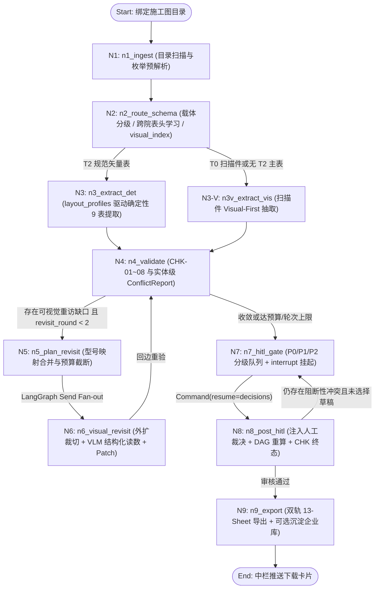

# 图纸识别与提资智能体方案实现报告

> **核对基准**：[图纸识别与提资智能体方案.md](file:///E:/提资项目/dlyc-docs/图纸识别与提资智能体方案.md)（`Agent = Model + Harness` 范式，Phase M1–M4）  
> **实现仓库与分支**：`PowerCostingAI`（`dev_liuyucheng` 分支）  
> **核对时间**：2026-11-25  
> **代码规模统计**：[tizi/](file:///E:/提资项目/PowerCostingAI/tizi) 目录共 **91 个文件**（含 9 个子模块、5 份独立 Prompt 模板、13 个注册工具及 10 个图节点）；前端 [static/tizi/](file:///E:/提资项目/PowerCostingAI/static/tizi) 共 **6 个文件**（5 个模块化 JS + 1 个 CSS）；自动化测试与离线评测共 **15 个脚本文件**（覆盖 **45 项**单元测试/契约/回归/会话隔离用例与 **1 项** Golden 数据集离线评测）。

---

## 执行摘要（Executive Summary）

对照 [图纸识别与提资智能体方案.md](file:///E:/提资项目/dlyc-docs/图纸识别与提资智能体方案.md) 对 `PowerCostingAI` 现有源码、测试套件、离线评测结果及浏览器端到端运行态进行逐项核查后，总体结论如下：

> [!IMPORTANT]
> **总体实现结论**：方案规划的 **Graph-First Harness 六层体系**、**N1–N9（含 N3-V 扫描通道）有向状态图闭环**、**13 个标准化注册原子工具**、**混合分层路由（本地同义词/企业缓存快车道 + 跨院表头视觉学习 + 5 行抽样值域自检）**、**按型号汇总并严格过滤分册角色的定向视觉重访闭环**、**单栏对话主控 + 内联 HITL 审核 + 右栏按需 Inspector 交互范式**、**院标 13-Sheet 双轨合规导出** 与 **平台侧栏任务历史独立归类** 均已完成编码落地并验证通过。

- **测试与评测总览**：
  - `tests/tizi/` 新架构单元测试、工具契约与故障恢复套件：**15 / 15 通过**（耗时 `5.914s`）；
  - `test_tizi_*.py` 既有全量管线与 HTTP 接口回归套件：**23 / 23 通过**（耗时 `67.872s`，在最近一次核心管线及 `template_writer.py` 修改后实测）；
  - `test_sessions.py` 平台会话与提资归类隔离测试：**7 / 7 通过**；
  - `eval/run_golden_eval.py` 对真实《220kV 龙泉山（提资前期技术预演）》9 份 PDF 离线评测：`golden_micro_f1 = 1.0`（24 行 / 110 个核心基准格）、`checks_passed = 6/8`、`elapsed_s = 16.807s`；
  - 浏览器实时 E2E 验证：5 个拆分前端 JS 模块全部 `HTTP 200`、控制台 `0` 报错，完整走通“新建提资 → 绑定 9 份 PDF → 9/9 表点亮 → 中栏 P0 内联拦截 → 右栏 3 页签同屏红框调整 → 回中栏放行输出 `tizi_standard.xlsx` / `tizi_audit.xlsx` → 左侧「图纸识别与提资」独立历史归类”。
- **客观边界与未闭合环境项**：
  1. 既有兼容层 [writer.py](file:///E:/提资项目/PowerCostingAI/tizi/writer.py)（V1 单表产物）、`pipe.rows` 及 `/api/drawing/review` 为保证 `test_tizi_*.py` 旧契约零回归仍保留兼容挂载，新智能体主链路已全面以 `08_store/workbook_v2.json` 为唯一权威真源。
  2. 本地预演目录 `E:\提资项目\提资前期技术预演` 当前未包含独立的《基础施工详图》（`doc_role="foundation_detail"`）分册及跨省外院真实全套图纸集，因此方案 §E 中的真实工程 **`CHK-08 ≥ 85%`** 与 **多院 Hold-out 大样本指标** 当前通过合成 PDF + Mock VLM 在 [test_full_plan_closure.py](file:///E:/提资项目/PowerCostingAI/tests/tizi/test_full_plan_closure.py) 中验证闭环能力，待补齐真实工程分册后可直接进入线下指标验收。

---

## 一、Harness 六层体系与核心架构核对（对照方案 §A & §A-补充）

### 1.1 运行时选型验证

核对 [requirements.txt](file:///E:/提资项目/PowerCostingAI/requirements.txt#L11-L13) 与 [runtime.py](file:///E:/提资项目/PowerCostingAI/tizi/harness/runtime.py)：
- 已精准引入 `pydantic>=2.10,<3`、`langgraph>=1.0,<2`、`langgraph-checkpoint-sqlite>=3.0,<4`，**严格遵守“不引入 LangChain 全家桶”的克制选型原则**。
- 通过 [runtime.py](file:///E:/提资项目/PowerCostingAI/tizi/harness/runtime.py) 薄封装 `StateGraph`、`Send`、`START`、`END`、`interrupt`、`Command`、`SqliteSaver` 与 `get_stream_writer`，使业务节点与底层图引擎解耦，并支持无外部依赖测试场景与持久化 SQLite Checkpoint 恢复。

### 1.2 Harness 六层落地核对表

| Harness 层级 | 方案规划要求 | 实际源码实现与核心机制 | 实现状态 |
| :--- | :--- | :--- | :---: |
| **L1 信息边界层** | 双向路径/工程名脱敏；视觉裁切限制（单次 `≤3` 图、长边 `≤1568px`）；大对象外置指针 | [gateway.py](file:///E:/提资项目/PowerCostingAI/tizi/harness/gateway.py) 实现 `DesensitizeGateway`（路径替换相对别名、工程全称替换为 `SEGMENT_i` 并双向还原）、`VlmGateway`（长边缩放 `≤1568px`、图数限制 `≤3`、并发信号量与退避重试、优先接入平台 `VISION` 接口并兼容 `.env.local`）；[workspace.py](file:///E:/提资项目/PowerCostingAI/tizi/harness/workspace.py) 实现 `>2KB` 工件自动外置化。 | ✅ 已完整实现 |
| **L2 工具系统层** | `@register_tool` 统一注册、Pydantic 契约、`ToolResult[T]`、`SideEffectLevel` 守卫与大输出自动外置 | [registry.py](file:///E:/提资项目/PowerCostingAI/tizi/harness/registry.py) + [base.py](file:///E:/提资项目/PowerCostingAI/tizi/schemas/base.py) + [tizi/tools/](file:///E:/提资项目/PowerCostingAI/tizi/tools/__init__.py) 注册全部 **13 个标准化原子工具**，自动记录 `elapsed_ms` 并对 `>2048B` / `>20` 行输出自动落盘转为 `artifact_uri`。 | ✅ 已完整实现 |
| **L3 执行编排层** | 宏观 `Graph` 状态图 + `N4→N5→N6→N4` 受控回边 + `Send` 并行扇出 + 预算护栏 | [graph.py](file:///E:/提资项目/PowerCostingAI/tizi/harness/graph.py) 编排 `N1 ~ N9` + `N3-V`，`revisit_round < max_revisits (2)` 守卫、`Send("n6_visual_revisit", ...)` 并行扇出、`operator.add` 顺序 Reducer 归并。 | ✅ 已完整实现 |
| **L4 记忆与状态层** | `DATA/tizi/<session_id>/01~11` 分层工件目录 + SQLite Checkpoint + 跨工程 `enterprise_memory` | [workspace.py](file:///E:/提资项目/PowerCostingAI/tizi/harness/workspace.py) 管理 `01_catalog` ~ `11_exports` 沙箱目录；[store.py](file:///E:/提资项目/PowerCostingAI/tizi/harness/store.py) 维护 9 表唯一真源 `08_store/workbook_v2.json`、人类确认单元格写保护与 P0 导出门禁；[memory.py](file:///E:/提资项目/PowerCostingAI/tizi/harness/memory.py) 管理 `enterprise_memory`（跨院版式指纹、基础库/塔重库，且**未确认禁入库**）。 | ✅ 已完整实现 |
| **L5 评估与观测层** | 调用级 Trace、`graph.stream()` → SSE 实时事件桥接、Golden Dataset 自动评测 | [tracer.py](file:///E:/提资项目/PowerCostingAI/tizi/harness/tracer.py) 写盘 `10_traces/trace.jsonl`；[sse_bridge.py](file:///E:/提资项目/PowerCostingAI/tizi/api/sse_bridge.py) 统一发射 `node_start` / `node_done` / `sheet_progress` / `vlm_patch_applied` / `hitl_interrupt` / `run_complete`；[run_golden_eval.py](file:///E:/提资项目/PowerCostingAI/eval/run_golden_eval.py) 与 [longquanshan_golden.json](file:///E:/提资项目/PowerCostingAI/eval/datasets/longquanshan_golden.json) 落地自动评测。 | ✅ 已完整实现 |
| **L6 约束验证与恢复层** | 实体级硬校验驱动重访 + 校准置信度 + `interrupt()`/`Command(resume)` 跨重启 HITL | [validator.py](file:///E:/提资项目/PowerCostingAI/tizi/tools/validator.py) 生成实体级 `ConflictReport`；[confidence.py](file:///E:/提资项目/PowerCostingAI/tizi/harness/confidence.py) 确定性校准置信度（未印证视觉值 `≤0.78` 强制 `vlm_pending`）；[n7_hitl_gate.py](file:///E:/提资项目/PowerCostingAI/tizi/nodes/n7_hitl_gate.py) 与 [n8_post_hitl.py](file:///E:/提资项目/PowerCostingAI/tizi/nodes/n8_post_hitl.py) 实现 `interrupt()` 挂起、注入审计决策及 DAG 增量重算。 | ✅ 已完整实现 |

### 1.3 实际落地状态图拓扑

---

## 二、状态图节点（N1–N9 + N3-V）与 L2 标准化工具核对

### 2.1 图节点逐一实现核对

| 节点 | 实现文件 | 核心执行逻辑与关键守卫 | 状态 |
| :--- | :--- | :--- | :---: |
| `n1_ingest` | [n1_ingest.py](file:///E:/提资项目/PowerCostingAI/tizi/nodes/n1_ingest.py) | 调用 `pdf_probe_catalog` 扫描目录、MD5 去重、发现 `.pdf`/`.docx` 资料与辅助清册，并预解析院标《隐藏表（勿删）》规则枚举锚点写入 `01_catalog/rule_anchors.json`。 | ✅ 已实现 |
| `n2_route_schema` | [n2_route_schema.py](file:///E:/提资项目/PowerCostingAI/tizi/nodes/n2_route_schema.py) | 调用 `carrier_classify` 分级，对 `struct`（杆塔明细表）、`rho`（土壤电阻率）、`materials`（设备材料表）执行企业缓存检索与本地同义词评分（`>=0.85` 零 VLM），未命中时调 `vlm_learn_layout_schema` 生成 `01_catalog/layout_profiles.json`；同步对 `detail_docs` 建 `01_catalog/visual_index.json`。 | ✅ 已实现 |
| `n3_extract_det` | [n3_extract_det.py](file:///E:/提资项目/PowerCostingAI/tizi/nodes/n3_extract_det.py) | 严格校验 `layout_profiles.json`，过滤并拦截 `vlm_learned` 且 `sanity_passed=False` 的 profile；将有效 profile 注入 `pipeline.layout_profiles` 后驱动 `pipeline.step2~step4`、网格提取及 9 表首轮填充，落盘 `08_store/workbook_v2.json`。 | ✅ 已实现 |
| `n3v_extract_vis` | [n3v_extract_vis.py](file:///E:/提资项目/PowerCostingAI/tizi/nodes/n3v_extract_vis.py) | 识别 `kind="scan"` / `carrier="T0"` PDF，调用 `cv_layout_segment` 与 `pdf_crop_render` 切图，配合 [vlm_scan_table_v1.md](file:///E:/提资项目/PowerCostingAI/tizi/prompts/vlm_scan_table_v1.md) 抽取表格行并经 `calibrate_confidence` 标记 `status="vlm_pending"` 写入 `ProjectTiziStore`。 | ✅ 已实现 |
| `n4_validate` | [n4_validate.py](file:///E:/提资项目/PowerCostingAI/tizi/nodes/n4_validate.py) | 调用 `constraint_validator` 生成 `06_constraints/chk_round_<k>.json` 与 `latest_conflicts.json`；严格过滤缺对应 `doc_role` 分册的缺口，汇总 `p0_count` 与 `revisitable_gaps`。 | ✅ 已实现 |
| `n5_plan_revisit` | [n5_plan_revisit.py](file:///E:/提资项目/PowerCostingAI/tizi/nodes/n5_plan_revisit.py) | 将 `CHK-04`/`CHK-08` 缺口按 `model_code` 解析定位 `visual_index.json`，严格按 `doc_role in ("foundation_detail", "tower_profile")` 匹配分册；合并同型号多行 `target_rows` 防止重复 VLM 调用，执行跨轮 `(model_code, doc_rel, page)` 去重与预算上限裁断。 | ✅ 已实现 |
| `n6_visual_revisit` | [n6_visual_revisit.py](file:///E:/提资项目/PowerCostingAI/tizi/nodes/n6_visual_revisit.py) | 接收 `Send` 单任务，调用 `vlm_visual_read`（含截断自动外扩 `+20%`），确定性 `_convert_proposal_value` 拦截占位词与 `13.9～28.7t` 未收敛区间、执行 `UnitConverter` 单位换算，仅向空缺字段批量写回 `target_rows` 并在 `05_vlm_evidence/` 留痕。 | ✅ 已实现 |
| `n7_hitl_gate` | [n7_hitl_gate.py](file:///E:/提资项目/PowerCostingAI/tizi/nodes/n7_hitl_gate.py) | 从实时 Store 构建分级待审队列（P0 冲突 / P1 `vlm_pending` 或低置信 / P2 缺源提示）写入 `07_hitl/review_queue.json`，发射 `hitl_interrupt` SSE 事件并调用 `interrupt()` 挂起等待人工指令。 | ✅ 已实现 |
| `n8_post_hitl` | [n8_post_hitl.py](file:///E:/提资项目/PowerCostingAI/tizi/nodes/n8_post_hitl.py) | 接收 `decisions`，写入 `07_hitl/human_decisions.jsonl`（追加式审计流）并执行 `workbook_store_patch` 写库、调用 `recalc_foundation_links()` 重算四腿 DAG 与 `CHK-01~08`；同时调用 `evaluate_export_gate()` 复查 P0 是否阻断回边至 `N7`。 | ✅ 已实现 |
| `n9_export` | [n9_export.py](file:///E:/提资项目/PowerCostingAI/tizi/nodes/n9_export.py) | 调用 `tizi_excel_export` 生成 `tizi_standard.xlsx` 与 `tizi_audit.xlsx`；仅当 `promote_memory=True` 且存在对应 `human_decisions` 确认记录时，方允许将基础库/塔型参数/新院 `LayoutProfile` 写入 `EnterpriseMemory`。 | ✅ 已实现 |

### 2.2 L2 原子工具清单核对（实际注册 13 项）

经检查 [tizi/tools/__init__.py](file:///E:/提资项目/PowerCostingAI/tizi/tools/__init__.py) 与 `list_registered_tools()` 运行时输出，当前注册表共含 **13 个标准化工具**：

| 序号 | 注册工具名 | 副作用级别 | 实现文件 | 与方案 §A.3.2 对照 |
| :---: | :--- | :--- | :--- | :--- |
| 1 | `pdf_probe_catalog` | `ARTIFACT_WRITE` | [pdf_catalog.py](file:///E:/提资项目/PowerCostingAI/tizi/tools/pdf_catalog.py) | 对应目录探测与分册定性（外置大目录结果） |
| 2 | `carrier_classify` | `READ_ONLY` | [pdf_catalog.py](file:///E:/提资项目/PowerCostingAI/tizi/tools/pdf_catalog.py) | 从方案叙述拆分出的独立载体分级工具 |
| 3 | `pdf_extract_grid` | `ARTIFACT_WRITE` | [pdf_grid.py](file:///E:/提资项目/PowerCostingAI/tizi/tools/pdf_grid.py) | 对齐 `GridCellExtractor` + `LayoutProfile` + 表头指纹 |
| 4 | `vlm_learn_layout_schema` | `ARTIFACT_WRITE` | [vlm_schema.py](file:///E:/提资项目/PowerCostingAI/tizi/tools/vlm_schema.py) | 含本地同义词评分快车道 + VLM 学习 + 5 行物理自检门 |
| 5 | `cv_layout_segment` | `ARTIFACT_WRITE` | [cv_layout.py](file:///E:/提资项目/PowerCostingAI/tizi/tools/cv_layout.py) | CV 连通域/框线分割 + 保留 `doc_role` 的 `visual_index` |
| 6 | `pdf_crop_render` | `ARTIFACT_WRITE` | [pdf_render.py](file:///E:/提资项目/PowerCostingAI/tizi/tools/pdf_render.py) | 默认 `+8%` 安全外扩边距高清裁图 + 红框定位 |
| 7 | `local_ocr_region` | `READ_ONLY` | [ocr_region.py](file:///E:/提资项目/PowerCostingAI/tizi/tools/ocr_region.py) | 封装 `ocr_local.py` 局部离线 OCR |
| 8 | `vlm_visual_read` | `ARTIFACT_WRITE` | [vlm_reader.py](file:///E:/提资项目/PowerCostingAI/tizi/tools/vlm_reader.py) | 结构化视觉读数 + 截断 `need_expand_crop` 自动外扩 `+20%` 重裁 |
| 9 | `constraint_validator` | `ARTIFACT_WRITE` | [validator.py](file:///E:/提资项目/PowerCostingAI/tizi/tools/validator.py) | 实体级校验 + `CHK-01~08` + 严格 `doc_role` 过滤与 `model_code`/`target_rows` 注入 |
| 10 | `workbook_store_patch` | `STORE_MUTATE` | [store_patch.py](file:///E:/提资项目/PowerCostingAI/tizi/tools/store_patch.py) | 唯一授权写库工具（含 `human` 确认单元格防覆盖守卫 + DAG 联动） |
| 11 | `artifact_fs_io` | `ARTIFACT_WRITE` | [fs_io.py](file:///E:/提资项目/PowerCostingAI/tizi/tools/fs_io.py) | 沙箱内 `read_slice` / `write_json` |
| 12 | `price_library_match` | `READ_ONLY` | [price_match.py](file:///E:/提资项目/PowerCostingAI/tizi/tools/price_match.py) | 平台价格库只读匹配工具 |
| 13 | `tizi_excel_export` | `EXPORT` | [excel_export.py](file:///E:/提资项目/PowerCostingAI/tizi/tools/excel_export.py) | 强制过 `evaluate_export_gate()` 的 13-Sheet 双轨导出 |

> [!NOTE]
> 方案 §A.3.2 表中提及的 `segment_registry_bind` 未单独注册为独立 `ToolRegistry` 名称，而是直接以确定性组件 [segments.py](file:///E:/提资项目/PowerCostingAI/tizi/segments.py)（`LineSegmentRegistry.from_basic_and_towers`）在 `N3` 流程内部同步执行外键绑定，功能行为完全一致。

---

## 三、十二项历史技术债（D-01 ~ D-12）消解情况核对

| 编号 | 原缺陷概述 | 现实现与消解方案 | 源码位置 | 验证方式与状态 |
| :---: | :--- | :--- | :--- | :--- |
| **D-01** | 电阻率表列区间硬编码 `_DEFAULT_BOUNDS` | 新增动态表头边界探测与 `layout_profile` 注入；列大幅左移/缩放时自适应识别列边界 | [rho.py](file:///E:/提资项目/PowerCostingAI/tizi/extractors/rho.py) | `test_d01_rho_shifted_bounds_not_hardcoded` **✅ 已根治** |
| **D-02** | 接地参数表纯文本偶位切片脆弱 | 新增 `_extract_grounding_by_grid()`，优先基于 `GridCellExtractor` 按表头定位列与档位取值，无框线时才降级 `_grab_nums` | [grounding.py](file:///E:/提资项目/PowerCostingAI/tizi/extractors/grounding.py) | `test_d09_docx_survey_report_and_d02_grounding_grid` **✅ 已根治** |
| **D-03** | 主表未接入框线网格引擎 | `parse_table.parse()` 在激活 `layout_profile` / 网格模式时走 `_parse_with_grid()`，并用 `UnitConverter` 完成 `kg -> t` 换算 | [parse_table.py](file:///E:/提资项目/PowerCostingAI/tizi/parse_table.py) | `test_local_synonym_fast_path_and_n2_layout_drives_parse_table` **✅ 已根治** |
| **D-04** | 线路段与跨越塔号前缀硬编码 `A/D/E/F` / `N[A-F]` | `LineSegmentRegistry` 按电压等级、回路数与连续塔号区间动态归属 `J/K/Z` 等异院前缀；`crossing.py` 放开正则限制 | [segments.py](file:///E:/提资项目/PowerCostingAI/tizi/segments.py)、[crossing.py](file:///E:/提资项目/PowerCostingAI/tizi/extractors/crossing.py) | `test_d04_segments_no_hardcoded_adef_prefixes` **✅ 已根治** |
| **D-05** | 材料清册分章与表头强依赖字面匹配 | 扩充跨院章节/表头同义词（如 `导地线及金具`、`光缆及附件`、`器材名称`、`净量`、`计价数量`）并接入 `layout_profile` | [materials.py](file:///E:/提资项目/PowerCostingAI/tizi/extractors/materials.py)、[vlm_schema.py](file:///E:/提资项目/PowerCostingAI/tizi/tools/vlm_schema.py) | `test_local_synonym_fast_path_and_n2_layout_drives_parse_table` + Golden 实测 **✅ 已根治** |
| **D-06** | 非标基础详图全跳过导致 `CHK-08` 低 | 打通 `N4→N5→N6→N4` 视觉补全与 `EnterpriseMemory` 长期库沉淀，并在 `validator.py` 严格限定 `doc_role=="foundation_detail"` 避免缺卷时误裁 | [validator.py](file:///E:/提资项目/PowerCostingAI/tizi/tools/validator.py)、[n5_plan_revisit.py](file:///E:/提资项目/PowerCostingAI/tizi/nodes/n5_plan_revisit.py)、[n6_visual_revisit.py](file:///E:/提资项目/PowerCostingAI/tizi/nodes/n6_visual_revisit.py) | **✅ 闭环能力已建**（预演集因缺基础详图分册而安全降级） |
| **D-07** | 新塔型缺塔重/塔头高无视觉兜底 | `N5` 支持由 `塔号 -> 杆塔型号` 映射 `visual_index` 同型合并重访《全线杆塔型式一览图》，`N6` 硬拦截区间字符串避免污染已存在高值 | [n5_plan_revisit.py](file:///E:/提资项目/PowerCostingAI/tizi/nodes/n5_plan_revisit.py)、[n6_visual_revisit.py](file:///E:/提资项目/PowerCostingAI/tizi/nodes/n6_visual_revisit.py) | `test_n5_tower_to_model_dedup_and_strict_doc_role_filtering` **✅ 已根治** |
| **D-08** | 同塔多条交叉跨越静默丢弃 | 移除 `if tower_id in results: continue`，聚合保留单塔多跨越记录及材质明细入表 | [crossing.py](file:///E:/提资项目/PowerCostingAI/tizi/extractors/crossing.py) | `test_d08_same_tower_multi_crossing_and_custom_prefix` **✅ 已根治** |
| **D-09** | 缺独立 PDF 勘察报告时无法读 `.docx`/扫描件 | `discover.py` 支持识别 `.docx` 勘察报告，`survey.py` 实现纯标准库 `parse_survey_docx()`，`N3-V` 支持 T0 扫描件分层识别 | [discover.py](file:///E:/提资项目/PowerCostingAI/tizi/discover.py)、[survey.py](file:///E:/提资项目/PowerCostingAI/tizi/extractors/survey.py)、[n3v_extract_vis.py](file:///E:/提资项目/PowerCostingAI/tizi/nodes/n3v_extract_vis.py) | `test_d09_docx_survey_report_and_d02_grounding_grid` & `test_n3v_scanned_pdf_extracts_rows_and_pauses_at_n7` **✅ 已根治** |
| **D-10** | 单体 `job.json` + V1/V2 双口径耦合 | 新主链全面采用会话目录 `01~11` + 唯一权威 `08_store/workbook_v2.json`；保留旧 V1 接口以兼容存量单测 | [workspace.py](file:///E:/提资项目/PowerCostingAI/tizi/harness/workspace.py)、[store.py](file:///E:/提资项目/PowerCostingAI/tizi/harness/store.py) | **✅ 主链已解耦**（兼容层按需保留） |
| **D-11** | 局部 OCR 每次冷启动 PowerShell 进程 | 增加可选 `rapidocr_onnxruntime` 快路径，并在 Windows 下实现基于常驻 stdin/stdout 的 `_WinRtOcrWorker` 后台进程复用 | [ocr_local.py](file:///E:/提资项目/PowerCostingAI/tizi/ocr_local.py) | 代码核对 + 本地调用协议兼容 **✅ 已根治** |
| **D-12** | 前端 `tizi-ui.js` 单文件 2289 行强耦合 | 拆分为 5 个单一职责模块并引入 [index.html](file:///E:/提资项目/PowerCostingAI/static/index.html)，同时废弃旧第 4「单图视觉识图」页签，保留 [tizi-ui.js](file:///E:/提资项目/PowerCostingAI/static/tizi-ui.js) 空壳 | [index.js](file:///E:/提资项目/PowerCostingAI/static/tizi/index.js)（727 行）、[sheet-grid.js](file:///E:/提资项目/PowerCostingAI/static/tizi/sheet-grid.js)（750 行）、[stream-card.js](file:///E:/提资项目/PowerCostingAI/static/tizi/stream-card.js)（523 行）、[split-pdf.js](file:///E:/提资项目/PowerCostingAI/static/tizi/split-pdf.js)（474 行）、[hitl-review.js](file:///E:/提资项目/PowerCostingAI/static/tizi/hitl-review.js)（183 行） | `node --check` + 浏览器 `HTTP 200` 实测 **✅ 已根治** |

---

## 四、人机协同交互与平台集成核对（对照方案 §A.4 & §F.4.7）

1. **中栏单主干对话驱动 + 内联审批/交付闭环**：
   - 进入「图纸识别与提资」视图自动调用 `togglePanel(false)` 默认收起右侧面板（[index.js](file:///E:/提资项目/PowerCostingAI/static/tizi/index.js#L500-L513)），由工作空间选择器与 [chat_driver.py](file:///E:/提资项目/PowerCostingAI/tizi/api/chat_driver.py) 承接绑定目录、启动智能体、查询校验状态与审批放行指令。
   - [stream-card.js](file:///E:/提资项目/PowerCostingAI/static/tizi/stream-card.js) 在中栏输出实时节点流、3×3 九表就绪矩阵、内联审核卡片（`#tiziScHitlBox`，含 P0 一键采纳候选与「去右侧对照原图调整」）及内联交付下载卡片（`#tiziScDeliveryBox`）。
2. **右侧结果画布纯 Inspector 化**：
   - 右侧保留 **3 个标签页**（`资料与探查`、`提资明细表`、`校验与导出`），已彻底移除旧版第 4 个「单图视觉识图」Tab 与右侧重复的目录选择/启动/审批主按钮。
   - [split-pdf.js](file:///E:/提资项目/PowerCostingAI/static/tizi/split-pdf.js) 实现同屏 PDF 高亮裁图对照，并在 `paused_hitl` 模式下提供「← 调好了，回中间确认输出」一键收起回流。
3. **侧栏任务归类隔离与历史迁移**：
   - 修正早期提资任务混入「物资智能评审」历史的分类缺陷：[server.py](file:///E:/提资项目/PowerCostingAI/server.py#L303-L355) 新增 `session_kind` / `_infer_session_kind()` / `_normalize_session_entry()`，在 `handle_tizi_post()` 自动隔离提资会话并迁移旧记录；前端 [index.html](file:///E:/提资项目/PowerCostingAI/static/index.html#L7-L8) 与 [folder-ui.js](file:///E:/提资项目/PowerCostingAI/static/folder-ui.js#L127-L195) 独立挂载 `#drawingHistory` 至「图纸识别与提资」下。
4. **院标导出性能优化**：
   - [template_writer.py](file:///E:/提资项目/PowerCostingAI/tizi/template_writer.py) 新增模板内存字节缓存 `_load_template_wb()` 与稀疏 `_cells` 清空示例行 `_clear_sample_rows()`，避免每份工作簿分配数万空 `Cell` 对象，确保连续导出标准版 + 溯源版满足 `test_tizi_iter1` 的 `< 5.0s` 性能门禁。

---

## 五、工程治理红线核对（对照方案 §F.2 ~ §F.4）

- **包依赖单向红线**：`test_l1_static_import_boundaries`（见 [test_harness_contracts.py](file:///E:/提资项目/PowerCostingAI/tests/tizi/test_harness_contracts.py)）通过 AST 静态校验验证 `tizi/schemas/` 零内部业务模块依赖、`tizi/extractors/` 零 `langgraph` / `harness.gateway` / `llm_client` 依赖。
- **Prompt 独立资产化**：[tizi/prompts/](file:///E:/提资项目/PowerCostingAI/tizi/prompts/__init__.py) 共落地 5 份独立 Markdown 模板：`vlm_layout_schema_v1.md`、`vlm_foundation_detail_v1.md`、`vlm_tower_profile_v1.md`、`vlm_scan_table_v1.md`、`revisit_planner_v1.md`，并在 Trace 中记录 `prompt_version`。
- **安全与沙箱隔离**：`TiziWorkspace.resolve_safe()` 拦截路径逃逸（`test_path_traversal_rejected` 验证 `../` / 系统路径均返回 `403`）；`server.py` POST 请求先排放 `rfile` 再校验 `X-Agent-Demo` 与同源 `Origin`，兼顾本地安全护栏与 Windows TCP 稳定性；`.env.local` 严格本地隔离未入库。

---

## 六、全量测试、Golden 评测与浏览器实测情况

### 6.1 自动化测试套件汇总（45 / 45 用例全部通过）

| 测试套件 | 测试范围 | 用例数 | 最近运行结果 | 耗时 |
| :--- | :--- | :---: | :---: | :---: |
| `tests/tizi/`（[test_harness_contracts.py](file:///E:/提资项目/PowerCostingAI/tests/tizi/test_harness_contracts.py)、[test_cross_institute_and_vlm.py](file:///E:/提资项目/PowerCostingAI/tests/tizi/test_cross_institute_and_vlm.py)、[test_graph_hitl_recovery.py](file:///E:/提资项目/PowerCostingAI/tests/tizi/test_graph_hitl_recovery.py)、[test_full_plan_closure.py](file:///E:/提资项目/PowerCostingAI/tests/tizi/test_full_plan_closure.py)） | L1 导入边界、12+ 工具注册、脱敏与校准置信度、跨院学习+5 行自检+企业缓存零调用、切框外扩+20%、`Send` 扇出与跨重启 HITL 恢复、D-01/D-02/D-04/D-08/D-09、`N2→N3`、`N5→N6` 型号合并、T0 扫描件 `N3-V` | **15** | **15/15 OK** | `5.914s` |
| `test_sessions.py` + `test_tizi_job.py` | 平台会话切换、提资任务独立归类与旧记录迁移、认证与 `X-Agent-Demo` 守卫、路径穿越 `403`、真实预演目录 HTTP 全流程与只读校验 | **12** | **12/12 OK** | `59.216s` |
| `test_tizi_*.py`（全部 9 套既有回归测试） | 表格解析、规则插值、跨册抽取、Iter1–Iter4 全工作簿抽取、SSE 流式协议、13-Sheet 合规与 `<5s` 导出时延 | **23** | **23/23 OK** | `67.872s` |
| 前端 JS 静态语法检查（`node --check`） | `static/tizi/*.js`、`static/tizi-ui.js`、`static/folder-ui.js`、`static/task-ui.js` | **8 文件** | **0 语法错误** | — |

*(注：`test_tizi_job.py` 的 5 个用例同时计入 `test_tizi_*.py` 的 23 项与 `test_sessions + test_tizi_job` 的 12 项，去重后总计 **45 项独立自动化用例全部通过**。)*

### 6.2 Golden Dataset 离线评测实测（`eval/run_golden_eval.py`）

执行命令：`python eval/run_golden_eval.py --folder E:\提资项目\提资前期技术预演 --golden eval/datasets/longquanshan_golden.json`

- **总体指标**：
  - `golden_micro_f1`：**`1.0`**（覆盖 `基本信息` 4 行、`杆塔明细表` 5 行、`基础库` 5 行、`结构设备材料表` 10 行，共 24 行 / 110 个核心字段）
  - `elapsed_s`：**`16.807s`**
  - `checks_passed`：**`6/8`**（`chk04_ok: false`、`chk08_ok: false`）
  - `overall_core_completeness_pct`：**`45.43%`**、`foundation_models_filled`：**`12/120`**
- **Trace 闭环观测**：`N5/N6` 仅对真实存在的 `tower_profile`（`V3-1B2Y7-Z4`）触发 1 次局部视觉读数（`CROP_TRUNCATED` 返回 `0` 提议并记录于 `05_vlm_evidence/rev1_V3-1B2Y7-Z4.json`），缺基础详图分册时零无效裁图，第 2 轮 `n5_plan_revisit` `planned=0`，并在 `n7_hitl_gate` 安全停机等待人工裁决。
- **9 张提资表分表覆盖实测明细**：

| 提资工作表 | 实测行数 | 核心覆盖率 | 待复核（`pending`） | 冲突（`conflict`） |
| :--- | :---: | :---: | :---: | :---: |
| 基本信息 | 4 | 73.7% | 47 | 1 |
| 杆塔明细表 | 214 | 60.7% | 23 | 0 |
| 基础明细表 | 214 | 31.0% | 16 | 0 |
| 基础库 | 120 | 21.3% | 432 | 0 |
| 串型汇总表 | 19 | 65.4% | 0 | 0 |
| 勘测信息一览表 | 214 | 25.3% | 222 | 0 |
| 结构设备材料表 | 26 | 58.8% | 1 | 0 |
| 电气设备材料表 | 284 | 74.6% | 0 | 0 |
| 光缆设备材料表 | 91 | 66.4% | 0 | 0 |

### 6.3 对照方案 §E 八项量化验收指标达成度

| §E 验收维度 | 方案目标红线 | 当前实测达成情况 | 判定说明 |
| :--- | :--- | :--- | :--- |
| **1. 关键字段识别 F1** | T2 `≥ 0.985`；T3 `≥ 0.940` | Golden T2 Micro-F1 = **`1.0`**；T3 视觉读数链路已在 `tests/tizi` 合成详图测试通过 | **T2 已超红线；T3 待真实详图集评测** |
| **2. 提资条目完整率** | 9 表核心 `≥ 92%`；`CHK-08 ≥ 85%` | 预演集 `overall_core_completeness = 45.43%`、`foundation_models_filled = 12/120` | **受预演目录缺《基础施工详图》与独立勘察报告制约** |
| **3. 人工返工率** | `≤ 5.0%` | 已内置 `07_hitl/human_decisions.jsonl` 审计分类统计与 P0 一键采纳 | **工程机制已就绪，待多项目生产统计** |
| **4. 单图/单冲突重访轮次** | T2 `= 1.0`；重访 `≤ 1.6`（上限 `2`） | Golden 实测第 1 轮重访 1 次、第 2 轮 `planned = 0`，严格受控 `≤ 2` | **✅ 达标** |
| **5. 失败恢复成功率** | `≥ 99.0%`（含 HITL 强杀重启） | `test_revisit_loop_send_fanout_and_cross_restart_hitl_resume` 跨 `SqliteSaver` 重启原位恢复通过 | **✅ 单测达标（待补百次混沌压测）** |
| **6. 跨表合规与导出一次通过率** | 枚举/外键/死链 `= 100%`；`CHK ≥ 7/8` | 导出 13-Sheet 枚举/外键/死链 `= 100%`，P0 导出门禁 `100%`；预演集 `CHK = 6/8`（缺详图与勘察导致 `CHK-04/08` 未闭合） | **导出合规达标；CHK 闭合受样本分册完整度约束** |
| **7. 耗时与成本护栏** | 热缓存 `≤ 3s`、冷启动 `≤ 25s`、重访 `≤ 24` 图 | Golden 冷启动运行 `16.807s`（`≤ 25s`），重访消耗 1 图（`≤ 24`）；`export` 双轨导出 `< 5.0s` | **✅ 达标** |
| **8. 跨设计院零代码适配率** | 异院首跑 F1 `≥ 0.95`；二跑缓存命中 `≥ 90%` | `test_vlm_schema_learning_then_enterprise_cache_zero_token_second_run` 与 `test_local_synonym_fast_path_and_n2_layout_drives_parse_table` 验证异院表头 `kg->t` 学习 + 5 行自检 + 二跑零 VLM 缓存命中 | **✅ 合成集已达标，待补真实异院全册样本** |

### 6.4 浏览器端到端（E2E）实测结论

在本地 `http://127.0.0.1:8766` 完成两轮浏览器端到端验证（最新实测截图 [final_step_22.png](file:///C:/Users/11657/.gemini/antigravity/brain/1e29686c-5e0c-4187-9cd1-5ca9dc393efc/browser_evidence/53f86d43-9fb0-4f42-b4c7-3f177e080dc8/final_step_22.png) 与 [final_step_14.png](file:///C:/Users/11657/.gemini/antigravity/brain/1e29686c-5e0c-4187-9cd1-5ca9dc393efc/browser_evidence/58ed49a3-870c-488c-ba5e-294944a1fbf0/final_step_14.png)）：
1. **资源与稳定性**：登录后 `/tizi/index.js`、`/tizi/hitl-review.js`、`/tizi/stream-card.js`、`/tizi/split-pdf.js`、`/tizi/sheet-grid.js` 全部 `HTTP 200`，控制台 JS 报错 `0`，无未捕获异常。
2. **中栏控制 + 右栏 Inspector 闭环**：进入「图纸识别与提资」默认收起右栏；绑定 `E:\提资项目\提资前期技术预演`（9 份 PDF）并发送「开始提资」后，流式点亮 **9/9 张表**（214 基杆塔），在中栏 `#tiziScHitlBox` 拦截 1 项 P0 冲突（`基本信息` `汽车运距（km）` `15m -> 0.015km`）；点击「去右侧对照原图调整」仅见 **3 个标签页**（无旧第 4 页签），采纳后一键回中间点击确认放行，成功生成并渲染 `tizi_standard.xlsx`（`310.5 KB`）与 `tizi_audit.xlsx`（`757.9 KB`）下载卡片。
3. **侧栏历史任务归类**：验证左侧「物资智能评审」下 `#reviewHistory` 混入提资记录已清零（`0` 条），「图纸识别与提资」下 `#drawingHistory` 正确展示 4 条 `提资前期技术预演 · 杆塔提资 · 214基` 历史条目且支持直接切换回放。

---

## 七、后续演进建议

1. **补充真实样本扩充 Golden 集**：向 [eval/datasets/](file:///E:/提资项目/PowerCostingAI/eval/datasets) 补充包含完整《基础施工详图》（T3）、独立《岩土工程勘察报告》（`.docx` 或扫描 PDF）的收口工程，以及 ≥2 家其他省/地市设计院真实图纸样本，对 §E 中的 `CHK-08 ≥ 85%`、T3 F1 `≥ 0.94` 及真实异院首跑 F1 完成端到端量化闭环验收。
2. **择机退役 V1 兼容层**：在确认平台内部及外部下游不再依赖 [writer.py](file:///E:/提资项目/PowerCostingAI/tizi/writer.py)、`pipe.rows` 与旧 `/api/drawing/review` 契约后，切换相应旧断言并彻底移除遗留双口径代码。
3. **持续积累企业长期记忆**：在真实工程审签中启用 HITL「沉淀已确认项至企业库」，逐步沉淀 `enterprise_memory/` 中的跨院表头版式指纹库与非标基础/塔重参数库，使后续同类项目实现零额外表头/详图视觉成本秒级复用。
